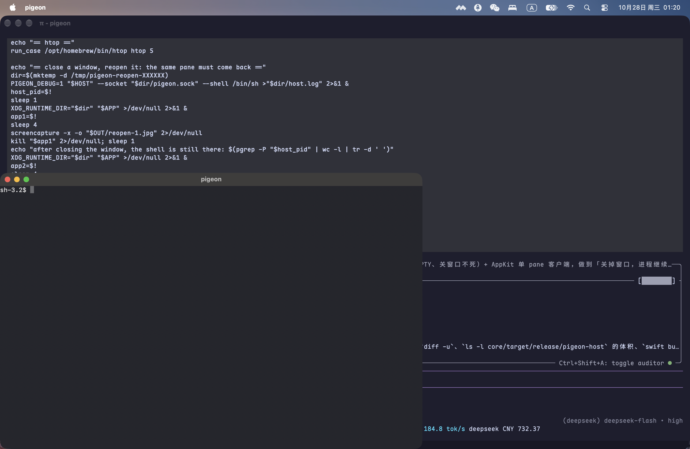

# M0 验收记录

> 能自动化的都用测试卡住；只能看的用截图。**没验到的写“未验”，不写成通过。**

## 1. 自动化（可复跑）

从仓库根目录：

```sh
cargo fmt --check                                  # 通过
cargo clippy --all-targets -- -D warnings          # 通过
cargo test                                         # 47 单元 + 9 ABI + 8 宿主端到端 = 64 passed
cargo build --release --bin pigeon-host            # 1,134,992 B（1.08 MiB ≤ 8 MiB）
cbindgen --config core/cbindgen.toml --crate pigeon-core \
         --output /tmp/pg.h core                   # 与 include/pigeon_core.h 无差异
cargo build                                        # 客户端链接用（core/target/*/libpigeon_core.a）
swift build                                        # 通过
swift test                                         # 15 个用例
```

`swift test` 需要完整 Xcode：`xcode-select` 指向 CommandLineTools 时 XCTest 缺失，
用 `DEVELOPER_DIR=/Applications/Xcode.app/Contents/Developer swift test`。

测试分布：

| 面 | 用例 |
|---|---|
| 内核 VT | 快照可复现、宽字符 width 2/0、备用屏 1049h/l、真彩色、脏行消费、resize |
| 快照重建 | `snapshot_rebuilds_every_cell`：feed → snapshot → 编码/解码 → 从消息重建 → 逐 cell（含 attrs/fg/bg/width/cursor/alt/scroll）相等 |
| OSC 7501 | 完整序列、跨 chunk 拼接、超长丢弃、base64 失败、控制字符、`clear` 子树、256 上限、生命周期（进程退出 / OSC 133A 提示符 / ack） |
| 协议 | 17 种消息往返、半包、>8 MiB、未知 `t` → unsupported、字段类型错、cell 4/5 元素 |
| C ABI | 生命周期、错误清除、消息编解码往返（hello/keys/snapshot/sessions） |
| 宿主端到端 | 断开→重连快照严格相等（cells/attrs/fg/bg/cursor/alt/scroll）；坏版本；未知消息不断开；`resize_pane` 后 `stty size` 读回 `30 100`；`close_pane` 终止子进程并从会话列表消失 |
| C ABI（内嵌） | `pg_core_new` → `pg_pane_new` → `pg_pane_feed` → `pg_pane_snapshot`：**宽字符 width 2 / continuation 0 穿过 C 边界**（GUI 走的正是这条路）；OSC 7501 记录经 `pg_status_*` 读出；DA1 应答经 `pg_pane_respond` 取出；布局返回整屏 rect |
| 真实程序 | `less` 翻页（空格后看到第 40 行）、`htop` 渲染面板并 `q` 干净退出、`vim` 打开文件并 `:q!` 退出 |
| Swift 逻辑 | KeyEncoder、NSEvent→KeyStroke 映射、Grouping、SidebarModel（排序/分组/needs-you/相对时间） |

## 2. 截图（`docs/images/m0/`）

同一份宿主 + 客户端，pane 里跑不同程序：

| 项 | 证据 |
|---|---|
| 提示符 + 方块光标 |  |
| vim：缓冲区 + 状态行 |  |
| less：首屏 + `(END)` |  |
| htop：CPU/内存面板 + 进程列表 |  |
| 真彩色 + 调色板反显 + 中文宽字符（width 修复后：CJK 不再被拉开） |  |
| 关窗后重开：同一个 pane 回来 |  →  |

一键复现（`tools/m0-gui-check.sh`，输出上面这些图）：

```sh
./tools/m0-gui-check.sh
# [htop] resize_pane sent: 1
# [htop] shell alive after the window closed: 1
# after closing the window, the shell is still there: 1
```

htop 的自动化用例（`htop_renders_its_panels_and_quits_on_q`）断言面板出现且 `q` 后
`pane_exited{code:0}`；less 翻页（`less_pages_forward_when_space_is_pressed`）断言空格后出现第 40 行。
两张图之外的行为（vim 退出、less 翻页、htop 退出）由这些用例覆盖，截图只是外观证据。

## 3. 未验（需要人或环境，不写成通过）

| 项 | 原因 |
|---|---|
| 物理键盘 | AppleScript 注入被 TCC 拒绝；改由 `PaneKeyTests`（AppKit 映射）+ 宿主 `keys` e2e 覆盖，真实按键仍待人按 |
| 拖动窗口边缘改尺寸 | 需要真实鼠标事件；`tools/m0-gui-check.sh` 打印「resize_pane sent: 1」，协议与 PTY 侧由 `resize_reaches_the_shell` 断言 `stty size` = `30 100`；真正拖动未测 |
| 重开窗口的像素级 diff | 已截 `reopen-1/2.jpg` 且宿主在关窗后仍持有子进程；两张图肉眼一致，但没有做逐像素比较 |
| Ubuntu 实跑 | 本机无 Linux；CI matrix 已配 ubuntu + macos |
| GitHub Actions 实跑 | 仓库无 remote，未推送；四个作业的命令已在本机按同顺序跑过 |

## 4. 已知缺口

见 `docs/plan.md` §11。
