# M0 验收记录

> 能自动化的都用测试卡住；只能看的用截图。**没验到的写“未验”，不写成通过。**

## 1. 自动化（可复跑）

从仓库根目录：

```sh
cargo fmt --check                                  # 通过
cargo clippy --all-targets -- -D warnings          # 通过
cargo test                                         # 47 单元 + 9 ABI + 8 宿主端到端 = 64 passed
cargo build --release --bin pigeon-host            # 1,134,992 B（1.08 MiB ≤ 8 MiB）
cbindgen --config core/cbindgen.toml --crate pigeon-core \
         --output /tmp/pg.h core                   # 与 include/pigeon_core.h 无差异
cargo build                                        # 客户端链接用（core/target/*/libpigeon_core.a）
swift build                                        # 通过
swift test                                         # 18 个用例
```

`swift test` 需要完整 Xcode：`xcode-select` 指向 CommandLineTools 时 XCTest 缺失，
用 `DEVELOPER_DIR=/Applications/Xcode.app/Contents/Developer swift test`。

测试分布：

| 面 | 用例 |
|---|---|
| 内核 VT | 快照可复现、宽字符 width 2/0、备用屏 1049h/l、真彩色、脏行消费、resize |
| 快照重建 | `snapshot_rebuilds_every_cell`：feed → snapshot → 编码/解码 → 从消息重建 → 逐 cell（含 attrs/fg/bg/width/cursor/alt/scroll）相等 |
| OSC 7501 | 完整序列、跨 chunk 拼接、超长丢弃、base64 失败、控制字符、`clear` 子树、256 上限、生命周期（进程退出 / OSC 133A 提示符 / ack） |
| 协议 | 17 种消息往返、半包、>8 MiB、未知 `t` → unsupported、字段类型错、cell 4/5 元素 |
| C ABI | 生命周期、错误清除、消息编解码往返（hello/keys/snapshot/sessions） |
| 宿主端到端 | 断开→重连快照严格相等（cells/attrs/fg/bg/cursor/alt/scroll）；坏版本；未知消息不断开；`resize_pane` 后 `stty size` 读回 `30 100`；`close_pane` 终止子进程并从会话列表消失 |
| C ABI（内嵌） | `pg_core_new` → `pg_pane_new` → `pg_pane_feed` → `pg_pane_snapshot`：**宽字符 width 2 / continuation 0 穿过 C 边界**（GUI 走的正是这条路）；OSC 7501 记录经 `pg_status_*` 读出；DA1 应答经 `pg_pane_respond` 取出；布局返回整屏 rect |
| 真实程序 | `less` 翻页（空格后看到第 40 行）、`htop` 渲染面板并 `q` 干净退出、`vim` 打开文件并 `:q!` 退出 |
| Swift 逻辑 | KeyEncoder、NSEvent→KeyStroke 映射、Grouping、SidebarModel（排序/分组/needs-you/相对时间）、渲染列定位（宽字符独占两列、续格跳过） |

## 2. 截图（`docs/images/m0/`）

同一份宿主 + 客户端，pane 里跑不同程序：

| 项 | 证据 |
|---|---|
| 提示符 + 方块光标 |  |
| vim：缓冲区 + 状态行 | 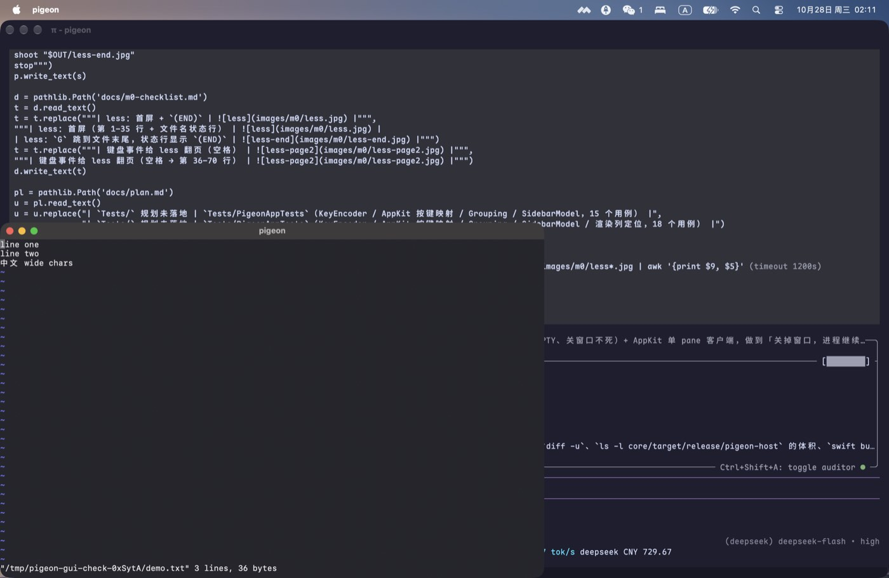 |
| less：首屏（第 1–35 行 + 文件名状态行） | 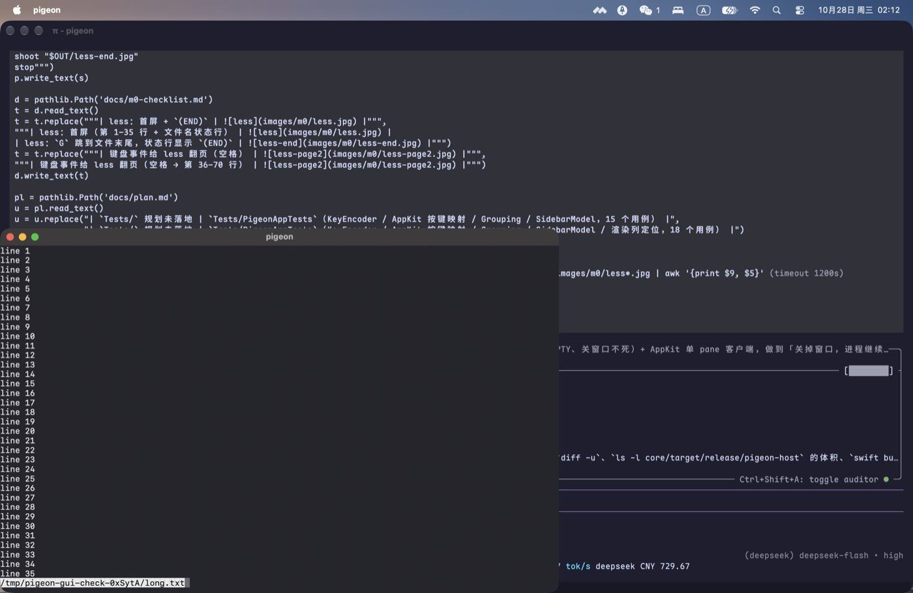 |
| less：`G` 跳到文件末尾，状态行显示 `(END)` | 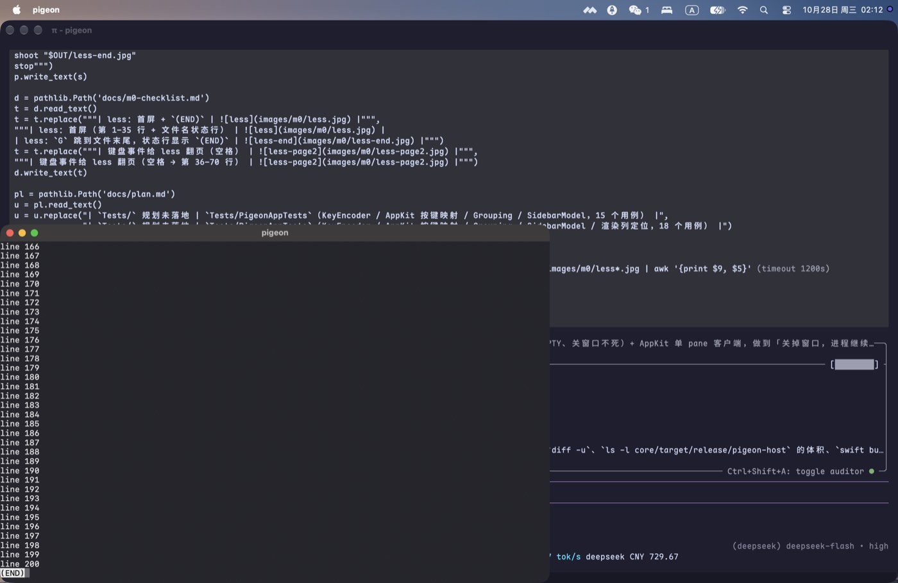 |
| 键盘事件：System Events 输入 `echo typed-by-a-human`（系统事件通道，非 App 内部调用） | 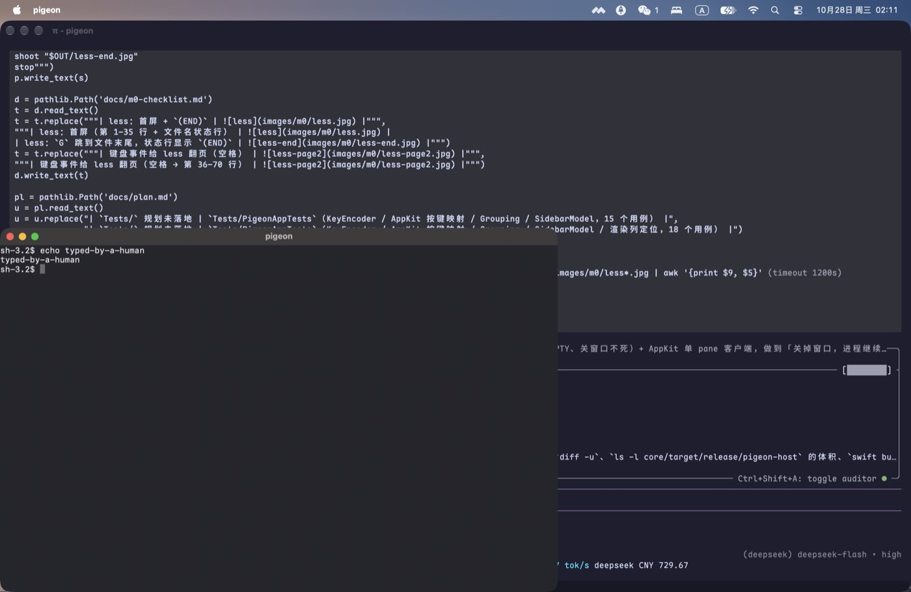 |
| 关窗→重开：vim 备用屏与内容原样回来；重开后脚本再进入插入模式补打 ` after-reopen`，截图里能看到这行新字 | 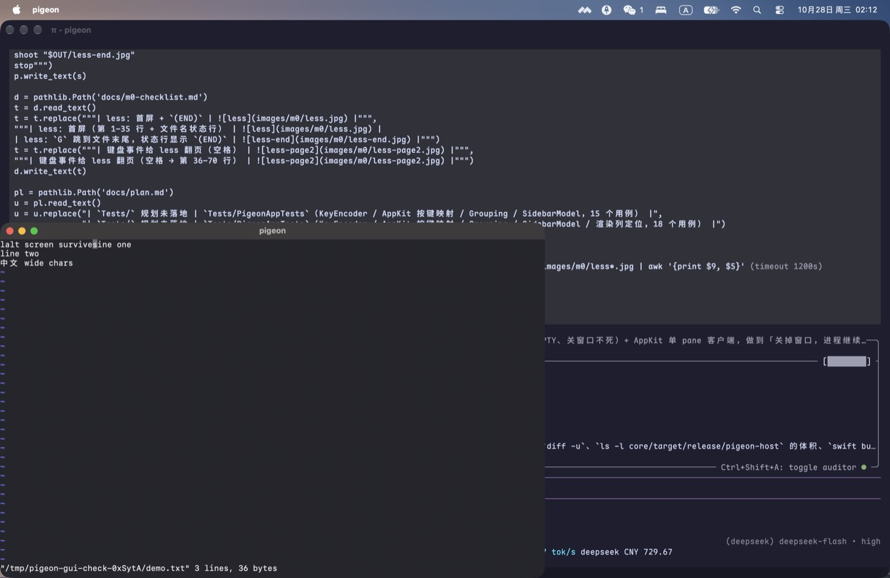 → 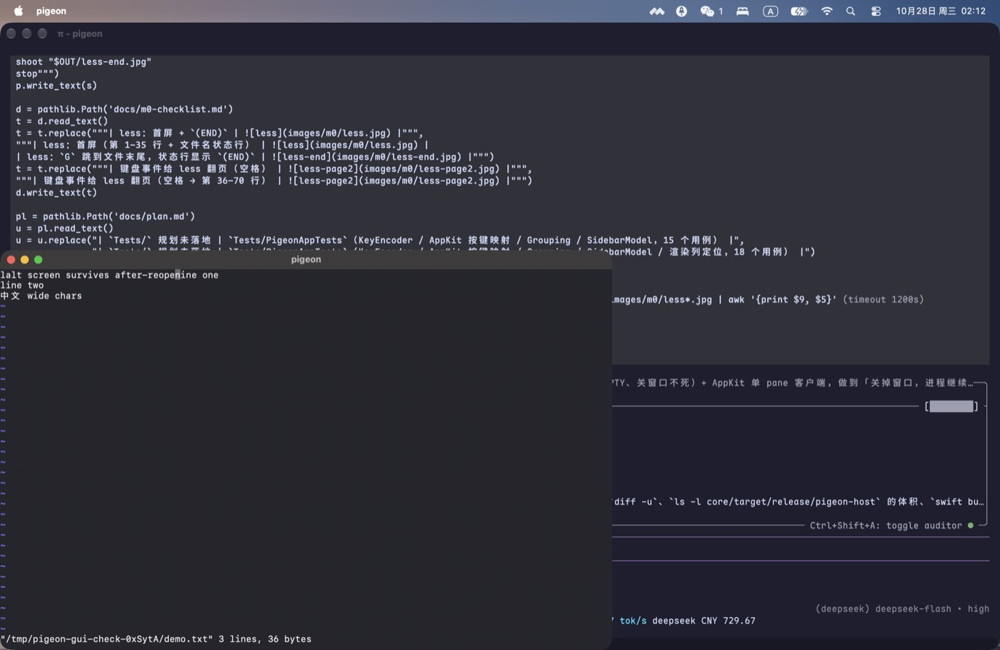 |
| 键盘事件给 less 翻页（空格 → 第 36–70 行） | 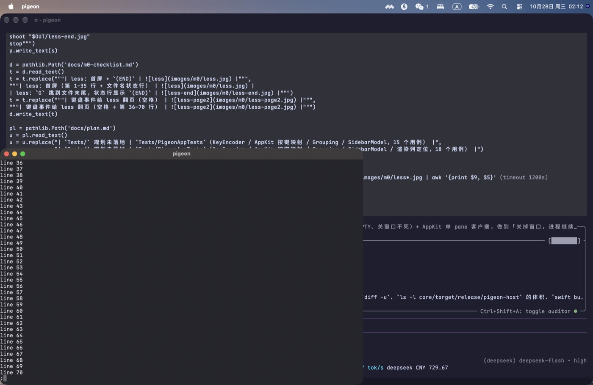 |
| 窗口改到 1200×700 后重绘（System Events 设置窗口尺寸） | 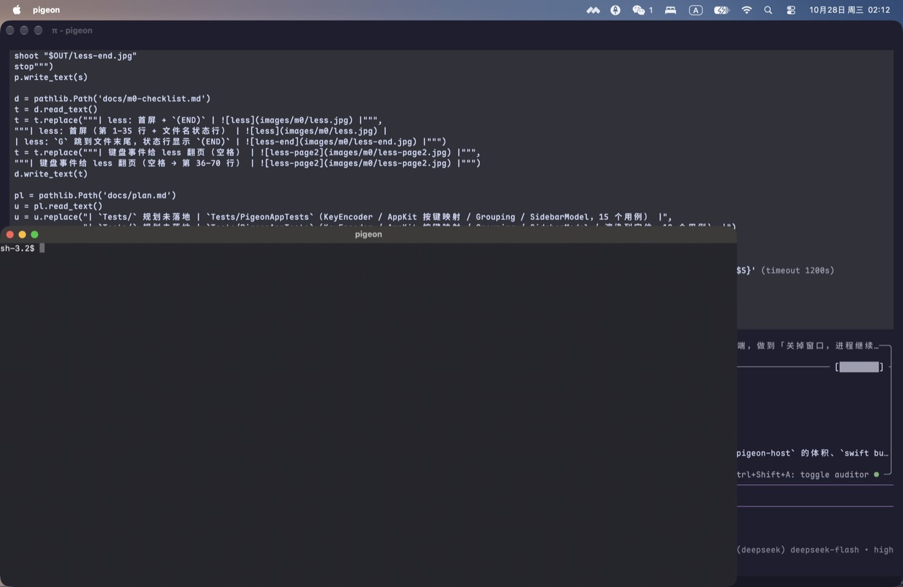 |
| htop：CPU/内存面板 + 进程列表 | 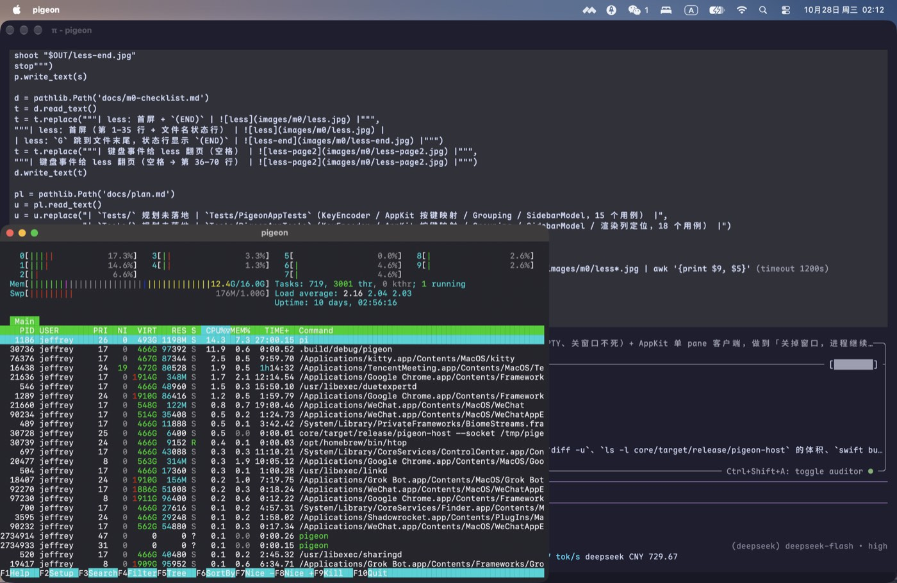 |
| htop：按 `q` 退出后回到 `sh-3.2$` 提示符（pane 是 `htop` 然后 `exec /bin/sh`；脚本打印 `htop processes after pressing q: 1`，那个 1 就是 shell） | 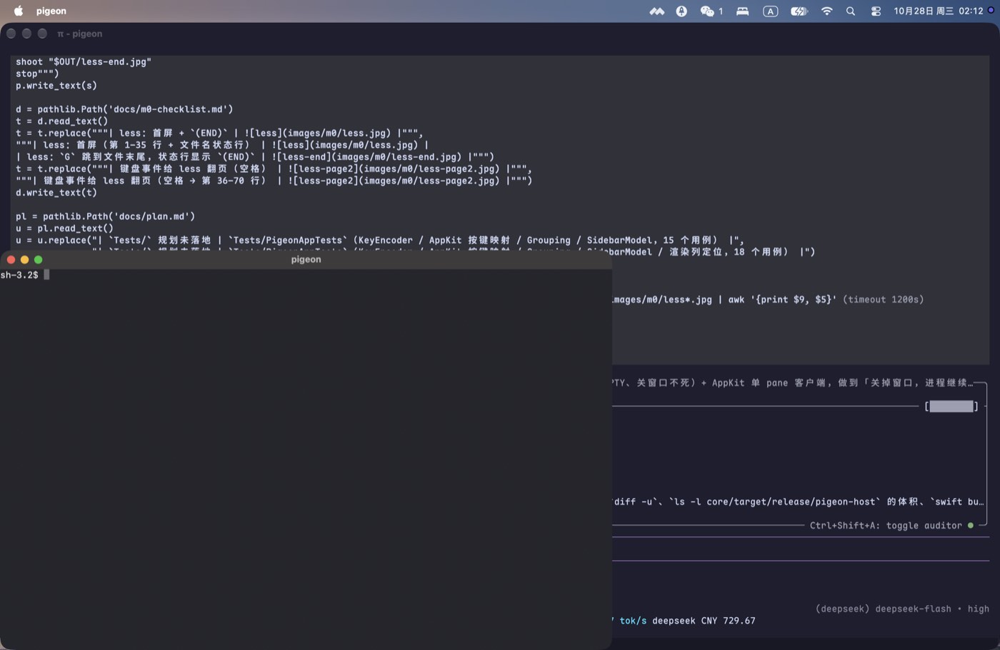 |
| 真彩色 + 调色板反显 + 中文宽字符（渲染器按列定位后：`中文宽字符` 占 10 列，后面的 `wide` 从第 11 列开始） | 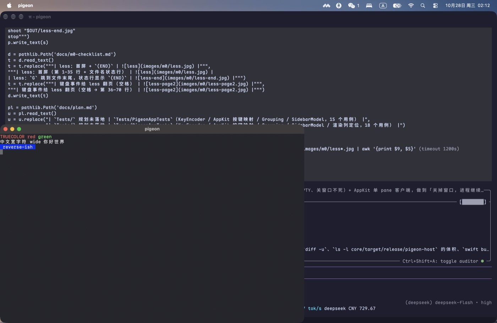 |

一键复现（`tools/m0-gui-check.sh`）：

```sh
cargo build --release --bin pigeon-host && cargo build && swift build   # 先构建
./tools/m0-gui-check.sh
```

真实输出（macOS，htop 3.5.3；没装 htop 时该段自动跳过）：

```text
== prompt ==
  pane processes after the window closed: 1
== typing in the shell ==
  pane processes after the window closed: 1
== vim first screen ==
  pane processes after the window closed: 1
== vim typing, close, reopen ==
  vim still running after the window closed: 1
  pane processes after the window closed: 1
== less: first page and one page down ==
  pane processes after the window closed: 1
== htop: render, quit with q, back to the prompt ==
  htop processes after pressing q: 1
  pane processes after the window closed: 1
== truecolor and wide characters ==
  pane processes after the window closed: 1
== resizing the window ==
  resize_pane before=1 after=2
  pane processes after the window closed: 1
```

`resize_pane before=1 after=2` 是窗口改成 1200×700 后又发了一次 resize；客户端网格从
111×36 变成 149×36（宿主 debug 日志可见）。

脚本自己生成 `demo.txt`、`long.txt`、`vim.sh`、`less.sh`（都在临时目录里，跑完删除），
所以新克隆的仓库不需要任何 `/tmp` 预置文件。

**这一步抓到两个真 bug**：

1. 窗口改大后 `PaneView` 先把 `cols/rows` 换成新尺寸、而 cell 缓冲还是旧的，渲染器踩越界崩了
   （`Fatal error: Range requires lowerBound <= upperBound`）。已修：`syncGrid()` 只改「请求的尺寸」，
   `cols/rows` 只由收到的快照更新；渲染器再加 `cells.count >= cols*rows` 守卫。
2. 宽字符对齐：渲染器原来把整行拼成一个 `CTLine`，而 CJK 字形的 advance 约 1.6 个等宽格，
   于是宽字符后面的内容整体左移。已改为**按列定位**：每段同色文本画在 `column * cellWidth`，
   宽字符独占一个 run（不让 CoreText 用它自己的 advance 影响后面），续格跳过。
   `RendererTests` 用纯逻辑断言这件事（`[A 中 cont B]` → 起点 0/1/3）。

htop 的自动化用例（`htop_renders_its_panels_and_quits_on_q`）断言面板出现且 `q` 后
`pane_exited{code:0}`；less 翻页（`less_pages_forward_when_space_is_pressed`）断言空格后出现第 40 行。
两张图之外的行为（vim 退出、less 翻页、htop 退出）由这些用例覆盖，截图只是外观证据。

## 3. 未验（需要人或环境，不写成通过）

| 项 | 原因 |
|---|---|
| 重开窗口的像素级 diff | `alt-1.jpg`/`alt-2.jpg` 是关窗前后两屏（vim 备用屏 + 输入的文字），肉眼一致；逐 cell 相等由宿主测试 `comparable()` 断言，但没有做逐像素比较 |
| 输入法 / 真实手速 | 本轮用系统事件注入按键，没测拼音候选窗（M6）与人类手速下的回显延迟 |
| Ubuntu 实跑 | 本机无 Linux；CI matrix 已配 ubuntu + macos，交给 CI 首跑 |
| GitHub Actions 实跑 | 仓库无 remote，未推送；四个作业的命令已在本机按同顺序跑过 |

## 4. 已知缺口

见 `docs/plan.md` §11。
