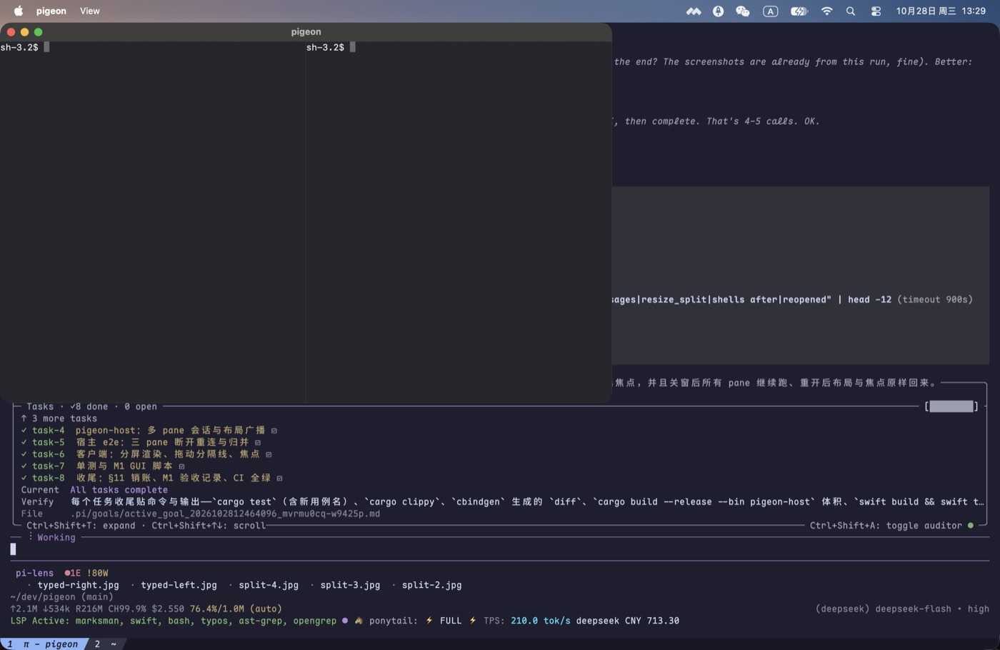
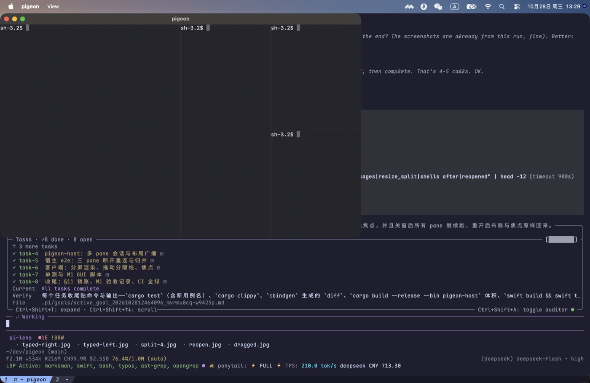
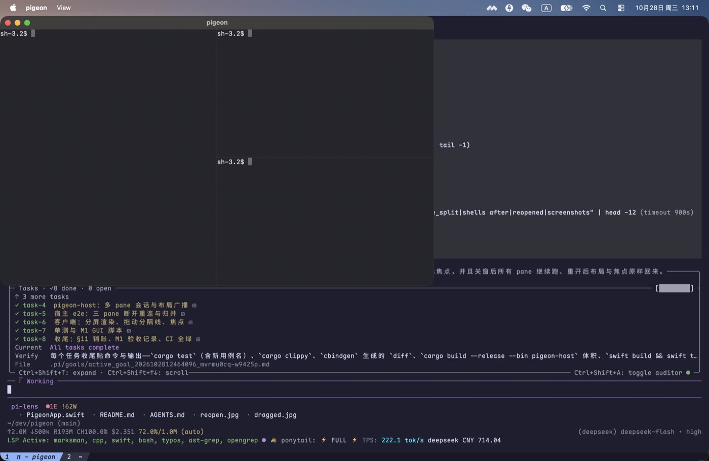
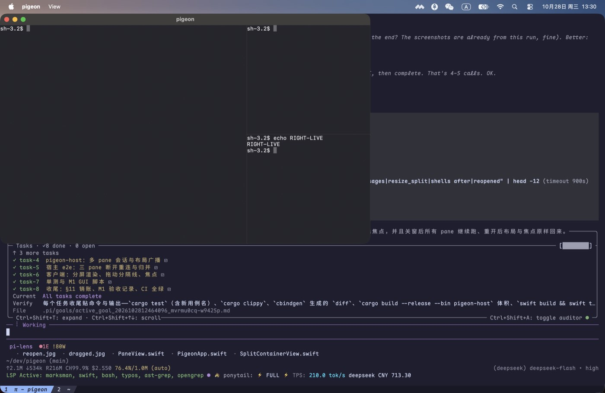
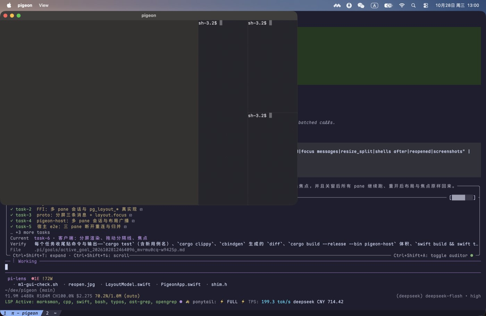

# M1 验收记录（分屏）

> 规则同 M0：能自动化的用测试卡住，只能看的用截图；没验到的写“未验”。

## 1. 自动化

从仓库根目录：

```sh
cargo fmt --check                                  # 通过
cargo clippy --all-targets -- -D warnings          # 通过
cargo test                                         # 64 单元 + 11 ABI + 14 宿主端到端 = 89 passed
cargo build --release --bin pigeon-host            # 1,201,200 B（1.15 MiB ≤ 8 MiB）
cbindgen --config core/cbindgen.toml --crate pigeon-core \
         --output /tmp/pg.h core                   # 与 include/pigeon_core.h 无差异
cargo build && swift build                         # 客户端链接 core/target/*/libpigeon_core.a
swift test                                         # 22 个用例
```

新增覆盖：

| 面 | 用例 |
|---|---|
| 布局树 | `layout::tests`（11 个）：左右/上下、三格、四格嵌套不重叠且面积和 = 1、关闭归并、关闭唯一 pane 变空、比例按最小尺寸夹取、`set_ratio` 夹取、焦点循环含回绕、关闭焦点后迁移、缺失 pane 报错、`split_of` 找分隔线、`describe` 与原树几何一致、**嵌套 split 按自己的 box 夹取**（100 列里内层只有 50 列，ratio 上限 0.8 而不是 0.9） |
| C ABI | `layout_splits_closes_and_focuses`（split 返回新 pane、rects 各 0.5、resize 夹到 0.9、focus 只能指向活 pane、close 后兄弟占满、split_of）、`layout_message_exposes_rects_and_splits`（layout 消息经 ABI 给出 rects/splits/focus） |
| 协议 | `SplitPane`/`ResizeSplit`/`Focus`/`Layout` 往返 + 两层树与 `focus`；反例：`axis="x"`、`ratio="half"`、`zoom_pane`/`unzoom` → `unsupported` |
| 宿主端到端 | `split_makes_three_live_panes`（三个 pane 各自 echo 自己的 marker）、`three_panes_survive_a_disconnect_and_restore_layout_and_screens`（叶子顺序/split id+axis+ratio/focus/每 pane 逐 cell 快照都一致）、`closing_a_pane_merges_it_into_the_sibling`、`resizing_a_split_changes_the_tree_and_the_panes`、`vim_alternate_screen_survives_a_reconnect`（vim 进备用屏后断开重连，`alt` 与整屏逐 cell 相等）、`zoom_messages_are_unsupported_at_the_host`（真 `zoom_pane`/`unzoom` 帧回 `unsupported`，随后 ping/pong 仍通） |
| Swift 纯逻辑 | `LayoutModelTests`（4 个）：divider 命中按轴且限定在它的 box 内、pane 命中、焦点循环回绕、`proposedRatio` 是纯坐标映射、空模型无焦点 |

## 2. GUI（真键盘 / 真鼠标，`tools/m1-gui-check.sh`）

脚本用 System Events 发快捷键、用 `cliclick` 发真实鼠标事件，窗口先被钉到 (0,0)/900×560。
真实输出（macOS）：

```text
panes before splitting: 1
after Cmd-D: 2 shells, 1 split_pane sent
after Cmd-Shift-D: 4 shells
focus messages: 1
after Cmd-W: 3 shells, close_pane sent 1
focus messages after Cmd-] and Cmd-[: 3
resize_split messages: 2, resize_pane 17 -> 23
shells after the window closed: 3
reopened window: 3 panes restored, 11 grid redraws with content
```


| 项 | 证据 |
|---|---|
| ⌘D 左右分屏 |  |
| 再来一次 → 三格 |  |
| ⌘⇧D → 四格 |  |
| ⌘W 关掉当前 pane | `after Cmd-W: 3 shells, close_pane sent 1`， |
| ⌘] / ⌘[ 切焦点 | `focus messages` 从 1 增到 3（宿主收到两次 `focus`） |
| 鼠标拖动第一个分隔线（450 → 560 → 600） | ；`resize_split messages: 2`，`resize_pane 17 -> 23`（两侧都被重新 fit） |
| 关窗后 3 个 shell 仍在 → 重开 | ，`3 panes restored, 11 grid redraws with content`，三块都能看到 `sh-3.2$` |

## 3. 这轮抓到的真 bug（都已修）

1. **协议缺 float 写入**：`SplitPane.ratio` / `ResizeSplit.ratio` 是 f32，但 C ABI 只有 u32/i32/bool/str/bytes 的 setter，
   客户端拼出来的消息被 schema 校验挡下（日志 `refusing to send an incomplete message`）。
   补了 `pg_msg_set_f32` / `pg_msg_get_f32`。
2. **客户端只 attach 第一个 pane**：重开窗口后另外三个 pane 是空白。改为收到 `layout` 就对尚未订阅的 pane 逐个 `attach`。
3. **split 不移动焦点**：新建的 pane 没成为焦点；宿主在 split 后显式 `layout.focus(new_pane)`。
4. **测试助手吃到过期 layout**：每次 attach 都会重播布局，测试改成「等到满足条件的 layout」再断言。
5. **重开窗口时第一块 pane 是空的**（审计用截图抓到的）：`sessions`/`created` 时先 attach，快照回来时
   容器里还没有这个 pane 的 view，`applySnapshot` 返回 false；随后 `attached` 已包含该 pane，layout 到来时
   不再重发。改为「`layout` 先建视图 → 对尚未拿到快照的 pane 逐个 attach」，并把早到的快照按 pane 暂存
   （`pendingSnapshots`）待视图出现后重放；脚本新增 `grid redraws with content` 断言，避免再靠计数自证。
6. **嵌套 split 的最小尺寸算错**：`set_ratio` 原来拿整会话的 cols/rows 夹取，嵌套时会把内层比例放得过大；
   改为先算出该 split 自己的 box 再夹（新增 `nested_split_clamps_against_its_own_box`）。

## 4. 未验 / 已知缺口

| 项 | 说明 |
|---|---|
| `zoom_pane` / `unzoom` | 协议按规范回 `unsupported`，UI 未做（见 `docs/plan.md` §11） |
| 分隔线拖动的“手感” | 只验证了拖拽会改变比例并重排，没有做最小宽度下的主观体验 |
| 侧栏 / SSH / IME | M3 / M4 / M6 |
| Ubuntu 实跑 | 已由 CI 覆盖，见 §5 |

## 5. CI（GitHub Actions，真跑）

代码提交 `4b925f1` 的 CI 一次通过（docs-only 的跟进提交同样全绿）：

<https://github.com/jeffrey-dot/pigeon/actions/runs/40636754201>

| 作业 | 结果 | 关键输出 |
|---|---|---|
| `docs` | success | 文档相对链接检查 `links ok` |
| `rust (ubuntu-latest)` | success | `cargo test` **64 + 11 + 14 = 89 passed**（含多 pane 与 vim 备用屏重连的宿主端到端） |
| `rust (macos-latest)` | success | 同上 |
| `header` | success | `cbindgen` 生成后 `diff -u` 为空 |
| `swift` | success | `cargo build` → `swift build` → `swift test` **22 passed** |
