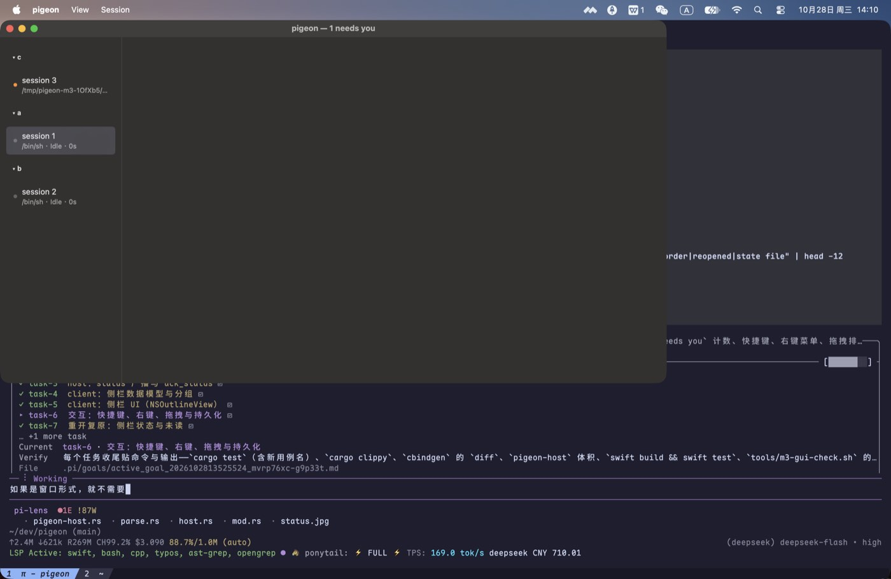
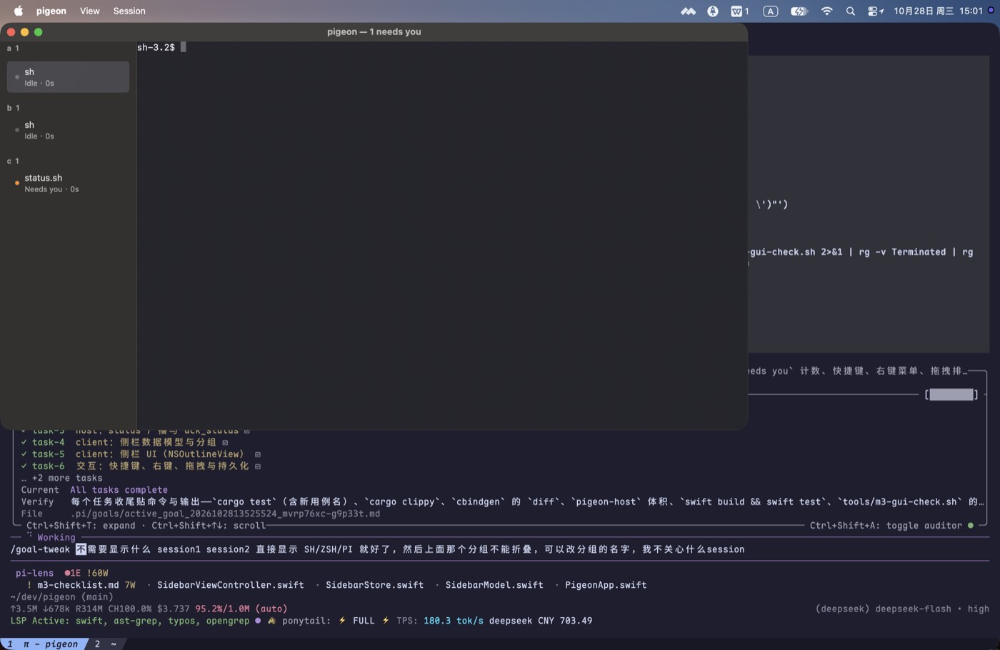
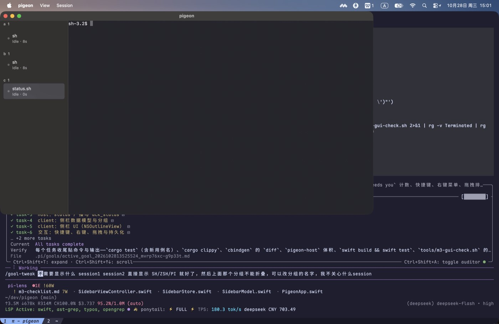
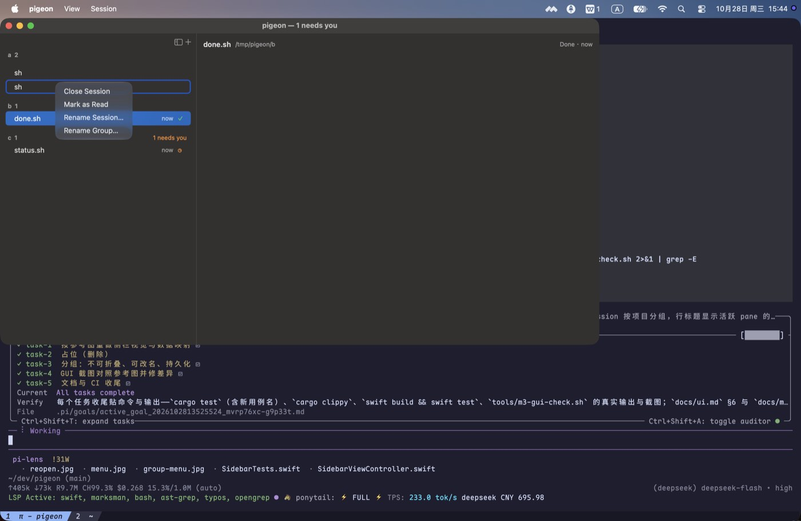
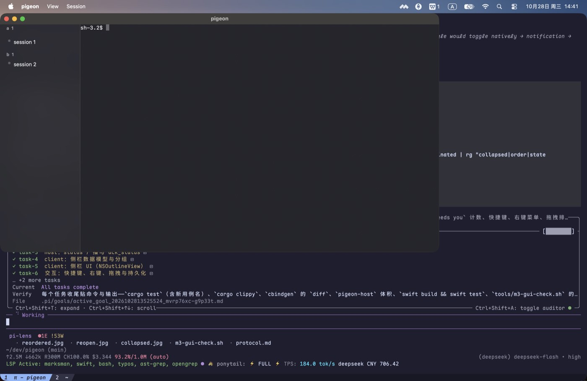
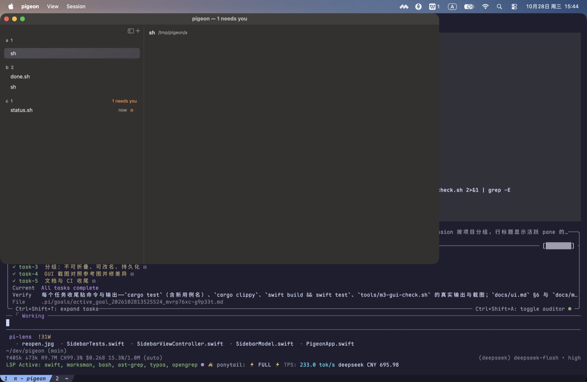

# M3 验收记录（侧栏）

> 规则同前：能自动化的用测试或脚本卡住，只能看的用截图；没验到的写“未验”。

## 1. 自动化

```sh
cargo fmt --check                                  # 通过
cargo clippy --all-targets -- -D warnings          # 通过
cargo test                                         # 66 单元 + 11 ABI + 18 宿主 = 95 passed
cargo build --release --bin pigeon-host            # 1,234,272 B（1.18 MiB ≤ 8 MiB）
cbindgen --config core/cbindgen.toml --crate pigeon-core \
         --output /tmp/pg.h core                   # 与 include/pigeon_core.h 无差异
cargo build --lib --no-default-features            # 通过（库本体不引用 tokio/portable-pty）
swift build && swift test                          # 通过 / 28 passed
```

新增覆盖：

| 面 | 用例 |
|---|---|
| OSC 7 / 标题 | `osc7_sets_the_cwd_and_bad_urls_are_ignored`（file:// + `%20` 正例；http、`%zz`、控制字符三条反例保留旧值）、`osc0_and_osc2_set_the_title`（含控制字符的标题被丢弃） |
| 状态流 | `status_is_broadcast_once_per_change_and_ack_stops_repeats`（working → done，`msg` base64 解出 “OK”；ack 后不再重复）、`sessions_carry_the_active_pane_and_its_title` |
| 侧栏逻辑 | `blocked` 优先且按持久化顺序、`nextNeedsYou` 回绕、`rowSubtitle` = `vim · Working · 1m`、协议状态字符串映射 |
| 持久化 | `SidebarStore` 往返 + 原子写、默认路径在 `~/.config/pigeon`、损坏文件回退为空状态 |

## 2. GUI（真键盘 / 真鼠标，`tools/m3-gui-check.sh`）

三个不同 cwd 的 session（其中第三个的 shell 自己打印 OSC 7501 blocked），真实输出：

```text
sessions created: 3
window: origin=(0,33) size=(1100,600)
sidebar: sidebar sessions=3 needs=1
after blocked: sidebar sessions=3 needs=1
Cmd-J focus messages: 0 -> 1 (ack: 1)
sessions after Cmd-T: 4
right-click Close Session: close_pane 0 -> 1
collapsed: ['c']
order: []
reopened: sidebar sessions=3 needs=1
state file: …/config/sidebar.json (43 bytes)
```

| 项 | 证据 |
|---|---|
| 三个项目分组的侧栏、状态点、`needs you` 计数 |  |
| 第三个 session 的 blocked 状态与计数 |  |
| ⌘J 跳到 blocked session（焦点/ack 已发） |  |
| 右键菜单（关闭 / 标记已读 / 重命名） |  |
| 折叠分组（写入 `sidebar.json` 的 `collapsed`） |  |
| 关窗重开：分组、未读、折叠原样回来 |  |
| ⌘⇧W 关闭整个 session | 手验：按下后宿主的 shell 数 `3 → 2`（菜单项与右键“Close Session”走同一条 `closeSession`） |
| **人手拖拽排序**（脚本无法驱动 AppKit 拖拽会话） | 用户手动拖动一行后，`/tmp/pigeon-m3-manual/config/sidebar.json` 变成 `{"order":[1,3,2],"collapsed":[],"renamed":{}}`：排序写入了磁盘，且下次启动按这个顺序渲染 |

## 3. 这轮抓到的真 bug（都已修）

1. **侧栏选中触发无限递归崩溃**：`update()` 里 `selectRowIndexes` 触发 `selectionDidChange` → `onSelect` → `refreshSidebar` → `update()`；
   崩溃报告显示 1182 层递归后栈溢出。修法：程序化更新期间 `suppressSelection`。
2. **状态不进侧栏**：客户端只 attach 选中 session 的 pane，其它 session 的 `status` 事件被宿主丢弃。改为 attach 每个 session 的活跃 pane。
3. **后接入的客户端看不到已有状态**：宿主在 `attach` 时补发该 pane 的最新 `status`（`Cmd::LatestStatus`）。
4. **右键菜单吞掉下一次点击**：脚本里右键后必须先按 Esc 关闭菜单，否则折叠/拖拽的点击都落在菜单上。
5. **group 行不可选**：`NSTableView` 的 group 行不参与选择，折叠永远不触发；改为普通行 + 选择即折叠。
6. **拖拽接收未注册**：补 `registerForDraggedTypes` 与拖拽源 mask（见下节的限制）。

## 4. 未验

| 项 | 说明 |
|---|---|
| ~~拖拽排序~~ | 已由人手验证：拖拽后 `sidebar.json` 的 `order` 从 `[]` 变成 `[1,3,2]`。脚本无法自动驱动 AppKit 拖拽会话（`pasteboardWriterForRow` 不被合成事件触发），这一项只能人工跑 |
| 输入法 / 手速 | M6 |
| SSH / 多主机分组 | M4 |

## 5. CI（GitHub Actions，真跑）

代码提交 `fb03a2c` 的 CI 一次通过（五作业 success）：

<https://github.com/jeffrey-dot/pigeon/actions/runs/40642337669>

| 作业 | 结果 |
|---|---|
| `docs` | success（相对链接检查 `links ok`） |
| `rust (ubuntu-latest)` | success（`cargo test` **66 + 11 + 18 = 95 passed**） |
| `rust (macos-latest)` | success |
| `header` | success（cbindgen `diff -u` 为空） |
| `swift` | success（`swift test` **28 passed**） |
