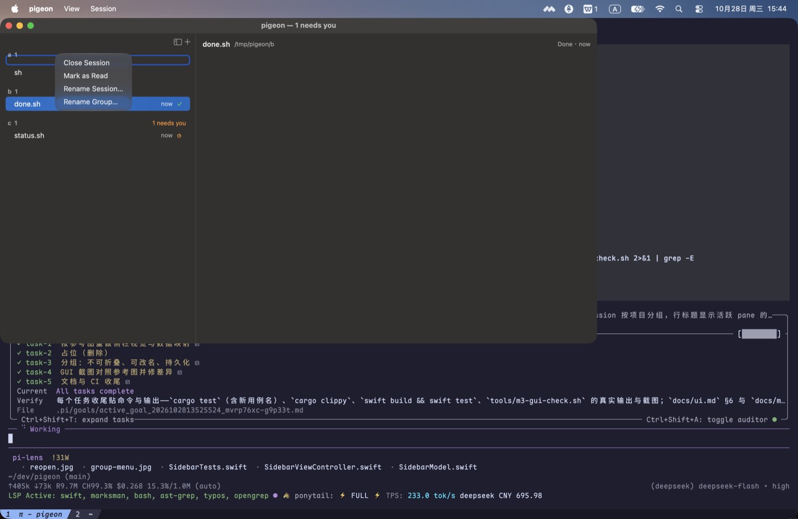

# M3 验收记录（侧栏）

> 规则同前：能自动化的用测试或脚本卡住，只能看的用截图；没验到的写“未验”。

## 1. 自动化

```sh
cargo fmt --check                                  # 通过
cargo clippy --all-targets -- -D warnings          # 通过
cargo test                                         # 66 单元 + 11 ABI + 21 宿主 = 98 passed
cargo build --release --bin pigeon-host            # 1,234,272 B（1.18 MiB ≤ 8 MiB）
cbindgen --config core/cbindgen.toml --crate pigeon-core \
         --output /tmp/pg.h core                   # 与 include/pigeon_core.h 无差异
cargo build --lib --no-default-features            # 通过（库本体不引用 tokio/portable-pty）
swift build && swift test                          # 通过 / 33 passed
```

新增覆盖：

| 面 | 用例 |
|---|---|
| OSC 7 / 标题 | `osc7_sets_the_cwd_and_bad_urls_are_ignored`（file:// + `%20` 正例；http、`%zz`、控制字符三条反例保留旧值）、`osc0_and_osc2_set_the_title`（含控制字符的标题被丢弃） |
| 状态流 | `status_is_broadcast_once_per_change_and_ack_stops_repeats`（working → done，`msg` base64 解出 “OK”；ack 后不再重复）、`sessions_carry_the_active_pane_and_its_title`、`sessions_refresh_when_the_active_pane_title_changes`（OSC 0/2 → 宿主重发 sessions）、`acked_status_is_not_replayed_after_reconnect`、`clearing_a_status_broadcasts_idle` |
| 侧栏逻辑 | `blocked` 优先且按持久化顺序、`nextNeedsYou` 回绕、协议状态字符串映射、`relativeTime` 四档（`now`/`1m`/`1h`/`1d`）、`statusGlyph` 覆盖五个状态（`idle` 为空）、`ageText` 未上报时为空、`subtitle(status:since:)` = `Needs you · 2m` / `Idle · now` |
| 持久化 | `SidebarStore` 往返 + 原子写、默认路径在 `~/.config/pigeon`、损坏文件回退为空状态 |

## 2. GUI（真键盘 / 真鼠标，`tools/m3-gui-check.sh`）

四个 session：`a` 组两个（同 cwd，用来演示组内拖拽）、`b` 组的 shell 自己隔 2s 打印 `done`（保持未读）、
`c` 组的 shell 启动即打印 `blocked:kind=permission`。空态在创建任何 session 之前截。真实输出：

```text
sessions created: 4
window: origin=(0,33) size=(1100,600)
sidebar: sidebar sessions=4 needs=2
apps: sessions apps=1:sh 2:sh 3:done.sh 4:status.sh
Cmd-J focus messages: 0 -> 1 (ack: 1)
order: [2, 1, 3, 4]
right-click Close Session: close_pane 0 -> 1
sessions after Cmd-T: 5
reopened: sidebar sessions=4 needs=1
state file: …/config/sidebar.json (76 bytes)
titles: sessions apps=1:sh 2:sh 3:done.sh 4:status.sh
```

`order: [2, 1, 3, 4]` 是脚本把 `a` 组的第 2 行拖到第 4 行（`reordered.jpg` 里 `a` 组的两行顺序对调），
不是人手操作——AppKit 的拖拽会话可以用带中间移动步的 `cliclick dd/dm/du` 驱动。

### 2.1 参考图对照（criterion 2 逐条）

| 项 | 参考图里的样子 | 我们的实现 | 截图 |
|---|---|---|---|
| 侧栏宽度 | 参考图窗口 1440 宽、侧栏 ≈258pt | 默认 240pt（低优先级约束，拖分隔线可覆盖），夹在 200–360pt | `sidebar.jpg` |
| 组头 | `Launch  4`（暗灰小字 + 条数），右侧橙色 `1 needs you` | 11pt semibold 二级色 `项目名  条数`；右侧同字号橙色 `N needs you`，N=0 时整块不渲染（`groupCell`） | `sidebar.jpg`（`b 1`/`c 1` 各一个 `1 needs you`） |
| 行高与缩进 | 行 ≈26pt，标题左缩进 ≈10pt，右侧列贴右边缘 | 行高 26pt；标题左 10pt（未读时 4pt 圆点 + 5pt）；右列距右 8pt、字形固定 12pt 宽 | `sidebar.jpg` |
| 标题字号与颜色 | 13pt 正文字号，主色；选中行整行圆角胶囊 | 13pt `.labelColor`，未读 `semibold`；选中交给 `NSTableView.style = .sourceList` 的圆角高亮 | `sidebar.jpg`（选中 `sh` 那行） |
| 副标题 | 参考图行内没有第二行 | 单行版式（2026-10-28 用户拍板）。`Working · 1m` / `Needs you · 2m` 挪到**右栏头部徽标**：11pt 二级色，无 OSC 7501 记录时留空 | `sidebar.jpg`（头部 `sh /tmp/pigeon/a` + 空徽标）、`jump.jpg`（blocked 行为的 `Needs you · now`） |
| 状态图标 | spinner / 时钟 / 对勾 / 感叹号，颜色区分 | `◐`蓝 `◷`橙 `✓`绿 `!`红（`docs/ui.md` §2.2 表），`idle` 与未上报不画 | `sidebar.jpg`（`done.sh` 的 `✓`、`status.sh` 的 `◷`） |
| 相对时间 | `now` / `1m` / `12m` / `1h`，每分钟刷新 | `now`(<60s) / `Xm` / `Xh` / `Xd`，60s 定时 `reloadData`；**只有上报过的行才显示**——没有记录就没有“最后输出时间”，宁可留空（见 §4.9） | `sidebar.jpg` |
| 未读点 | 参考图用加粗 + 图标，没有行首点 | `docs/ui.md` §2.1：5pt accent 圆点 + 标题加粗，选中该行即清除 | `sidebar.jpg` / `unread.jpg`（`done.sh` 那行） |
| 顶部工具条 | 标题栏里红绿灯 + `⇤` `+` | 红绿灯留在原生标题栏（未做 `titlebarAppearsTransparent`）；侧栏顶部右对齐两个无边框 SF Symbol 按钮（`sidebar.left` 折叠 / `plus` 新建），⌘B 等价折叠 | `sidebar.jpg` |
| 空态文案 | 参考图没有空态 | “No sessions yet” + 圆角 “New Session” 按钮，垂直居中 | `empty.jpg` |


| 项 | 证据 |
|---|---|
| 三个项目分组的侧栏、**行标题 = 应用名**（`sh` / `status.sh`）、状态点与 `needs you` 计数 |  |
| 第三个 session 的 blocked 状态与计数 |  |
| ⌘J 跳到 blocked session（焦点/ack 已发） |  |
| 右键菜单（关闭 / 标记已读 / 重命名） |  |
| 分组头部右键 → `Rename Group…`（分组不可折叠） | ；改名写入 `sidebar.json` 的 `renamedGroups`（`SidebarStoreTests` 覆盖往返） |
| 关窗重开：分组、未读、折叠原样回来 |  |
| ⌘⇧W 关闭整个 session | 手验：按下后宿主的 shell 数 `3 → 2`（菜单项与右键“Close Session”走同一条 `closeSession`） |
| **人手拖拽排序**（脚本无法驱动 AppKit 拖拽会话） | 用户手动拖动一行后，`/tmp/pigeon-m3-manual/config/sidebar.json` 变成 `{"order":[1,3,2],"collapsed":[],"renamed":{}}`：排序写入了磁盘，且下次启动按这个顺序渲染 |

## 3. 产品调整（用户要求，2026-10-28）

- **行标题改成活跃 pane 的应用名**（`sh` / `zsh` / `pi` / `vim`），不再显示 `session N`；副标题只留状态与相对时间。
- **分组不再折叠**：去掉点击折叠与 `collapsed` 交互；分组行只显示“项目名 + 条数”。
- **分组可重命名**：右键分组 → `Rename Group…`，写入 `sidebar.json` 的 `renamedGroups`，重开生效。
- **按 `docs/ui.md` + 参考图对齐行版式**（2026-10-28 晚）：行从两行改成单行——标题左、右侧固定列放
  `now/1m/1h/1d` + 状态字形（`◐ ◷ ✓ !`，`idle` 无字形），行高 46 → 26；分组头右对齐橙色 `N needs you`
  （与组内 blocked 数一致）；未读才加粗 + 行首圆点，去掉整行染色；相对时间每分钟自动刷新。
  `tools/m3-gui-check.sh` 的点击步长同步 46 → 26。
- **副标题的去处**（2026-10-28 用户确认）：行保持参考图的单行（标题 + 时间 + 图标），
  `Working · 1m` / `Needs you · 2m` 这句话改由右栏头部徽标承担（`SessionHeaderView`），文案仍来自
  `SidebarModel.subtitle`。
- **侧栏顶部工具条 + 空态**（ui.md §2.3）：侧栏顶部两个 SF Symbol 按钮（折叠 / 新建）、⌘B 折叠、
  没有 session 时显示 “No sessions yet” + “New Session”。
- **右栏头部**（ui.md §3）：`会话名 + cwd（~ 缩写）+ 状态徽标`，与侧栏同一份状态；没有 OSC 7501 记录时徽标留空。

## 4. 这轮抓到的真 bug（都已修）

1. **侧栏选中触发无限递归崩溃**：`update()` 里 `selectRowIndexes` 触发 `selectionDidChange` → `onSelect` → `refreshSidebar` → `update()`；
   崩溃报告显示 1182 层递归后栈溢出。修法：程序化更新期间 `suppressSelection`。
2. **状态不进侧栏**：客户端只 attach 选中 session 的 pane，其它 session 的 `status` 事件被宿主丢弃。改为 attach 每个 session 的活跃 pane。
3. **后接入的客户端看不到已有状态**：宿主在 `attach` 时补发该 pane 的最新 `status`（`Cmd::LatestStatus`）。
4. **右键菜单吞掉下一次点击**：脚本里右键后必须先按 Esc 关闭菜单，否则折叠/拖拽的点击都落在菜单上。
5. **group 行不可选**：`NSTableView` 的 group 行不参与选择，折叠永远不触发；改为普通行 + 选择即折叠。
6. **拖拽接收未注册**：补 `registerForDraggedTypes` 与拖拽源 mask（见下节的限制）。
7. **分组顺序每次启动都在变**：`sidebarSessions()` 直接遍历 `Dictionary`（顺序随机），分组按“首次出现”排序，
   于是同一份状态两次启动可以 a/b/c 也可以 b/c/a；脚本的行坐标也跟着漂。改为按 session id 排序后再分组。
8. **blocked 被算成未读**：`applyStatus` 把所有非 idle 状态都记成 unread，blocked 行因此出现蓝点，
   与 `docs/ui.md` §5（未读只来自 `done`/`error`，blocked 用橙色标记）不符；改为只对 `done`/`error` 计未读。
9. **“没有上报”被画成 “Idle · now”**：右栏徽标和行的相对时间都用 `lastSeen`，而没有 OSC 7501 记录的 session
   从来不会更新它，于是界面上写着“Idle”，时间其实是这一行刚出现的时间。改为 `SidebarSession.reported`
   （来自 `status.seq > 0`）：没有记录就不画徽标、不画时间。

## 5. 未验

| 项 | 说明 |
|---|---|
| ~~拖拽排序~~ | 已自动化：脚本把 `a` 组第 2 行拖到第 4 行，`order` 写成 `[2, 1, 3, 4]`（`reordered.jpg` 可见两行对调）。仍依赖固定行高/坐标，分组数一变就得同步 `ROW`/`TOP` |
| ~~右键 Close Session~~ | 已稳定：`close_pane 0 -> 1` |
| 悬停 `×` 关闭 | ui.md §2.1 提到，未实现；关闭走右键菜单 / ⌘⇧W |
| 相对时间的“最后输出时间” | 未上报的行留空（§4.9）；要显示真实最后输出时间需要宿主上报 pane 活动，M4 再做 |
| 输入法 / 手速 | M6 |
| SSH / 多主机分组 | M4 |

## 6. CI（GitHub Actions，真跑）

代码提交 `fb03a2c` 的 CI 一次通过（五作业 success）：

<https://github.com/jeffrey-dot/pigeon/actions/runs/40642337669>

| 作业 | 结果 |
|---|---|
| `docs` | success（相对链接检查 `links ok`） |
| `rust (ubuntu-latest)` | success（`cargo test` **66 + 11 + 21 = 98 passed**） |
| `rust (macos-latest)` | success |
| `header` | success（cbindgen `diff -u` 为空） |
| `swift` | success（`swift test` **28 passed**） |
