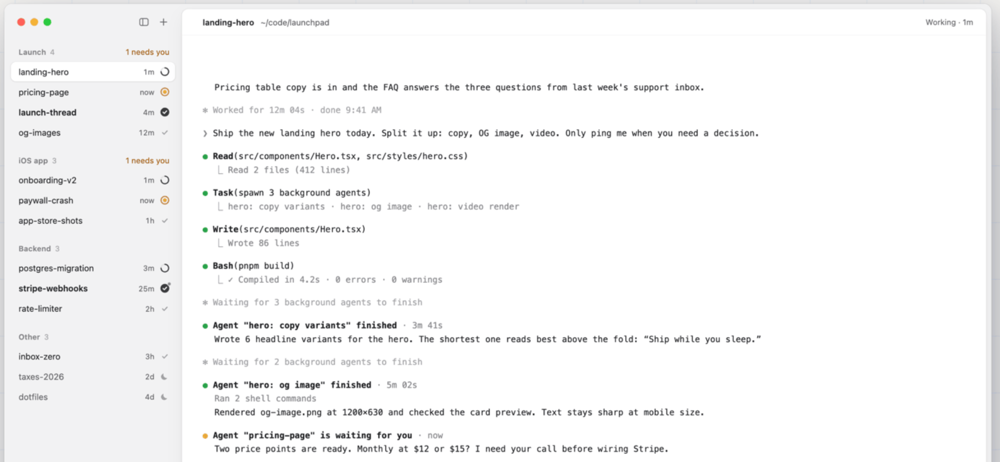

# pigeon UI 规格（侧栏 + 终端）

主界面依据用户提供的 Harp 截图：左侧按项目分组的单行会话列表，右侧为圆角卡片中的真实终端。
浅色与深色的尺寸、色值及材质取自 Harp 源码；界面随系统外观即时切换。

## 1. 参考与来源

- 源码：[dominikmartn/harp](https://github.com/dominikmartn/harp)，核对版本
  `54c5286078484ab38304bf8be1052f9c60f26a90`。
- `app/src/workspace/view/vertical_tabs.rs`：`sidebar` 的尺寸、`colors`、`row_line`、`status_icon`。
- `app/src/workspace/view.rs`：卡片圆角、外缩、描边、阴影和内容内边距。
- `app/src/themes/default_themes.rs`：`dark_theme()` / `light_theme()` 的终端前景和背景。
- 只参考布局、规格与色值。视图、约束和状态绘制由 AppKit / Core Animation 实现，不复制 Harp 的实现或图形资源。

## 2. 窗口与终端卡片

| 项目 | 实现 |
|---|---|
| 窗口 | 原生红绿灯、透明统一标题栏、隐藏窗口标题；最小内容区 640 × 400pt |
| 侧栏 | 默认 272pt，可拖到 200–360pt；顶部 56pt，右侧折叠与新建按钮 |
| 顶部按钮 | 28 × 28pt，7pt 悬停圆角，17pt 系统符号；与红绿灯中心对齐 |
| 卡片 | 上、右、下各外缩 8pt，左边贴侧栏；圆角 10pt、0.5pt 描边 |
| 卡片阴影 | 向下 4pt，模糊 16pt |
| 头部 | 40pt 高；左内边距 32pt，侧栏隐藏时 84pt；右内边距 20pt |
| 头部内容 | 会话名、工作路径、右对齐的 `Working · 1m` 等状态；任务和等待原因放在提示中 |
| 头部截断 | 路径从开头截断，标题从结尾截断；状态最多占宽度的 45%，完整内容可悬停查看 |
| 终端 | 与卡片同底色，左内边距 32pt；分屏、滚动、选择、输入法仍由终端视图处理 |
| 侧栏分隔线 | 保留原生拖动区域，不重复绘制系统分隔线；卡片边缘负责视觉分隔 |

标题栏下方的卡片头部与侧栏按钮同一水平带，终端内容从头部下方开始。
终端中显示的是程序实际输出；没有对话转录重排或屏幕内容识别。

## 3. 侧栏

### 3.1 项目和机器

- 分组按 cwd 上溯到 git 根目录；不在 git 中时用 cwd 最后一级目录。
- 只有本机会话时，列表直接从项目开始。
- 有远端会话时，每台机器有独立标题；同名项目仍按机器隔离，点击后切换到对应机器的会话。
- 组头显示项目名、会话数、`1 needs you` / `N need you`。
- `needs you` 计数包括 blocked、error 和未读 done；blocked 优先排序，其余维持已有排序规则。
- 组头不折叠，右键可重命名。悬停显示 `+`，在该项目目录新建会话；移开后计数靠右恢复。

### 3.2 会话行

一行依次为 `名称 → 相对时间 → 状态图标`。标题起点与项目名对齐。

| 项目 | 数值 / 行为 |
|---|---|
| 行高 / 间距 | 30pt / 1pt，任务说明不增加行高 |
| 列表左右留白 | 10pt |
| 行内左右留白 | 左 12pt，右 8pt |
| 行内间距 | 8pt |
| 组头 | 28pt，组间空隙 14pt；首组不加组间空隙 |
| 行标题 | 13pt，未读 semibold；长标题尾部截断 |
| 时间 | 10pt 等宽数字；`now` / `1m` / `3h` / `2d`，每分钟刷新 |
| 状态 | 15pt 字形，占 16 × 16pt 的行尾槽位 |
| 选中 | 8pt 圆角、0.5pt 描边和轻阴影；失焦使用安静选中色 |
| 悬停关闭 | 18pt `×` 替换状态槽位，时间和标题位置保持稳定 |
| 任务说明 | 名称、目录、任务/等待原因、尺寸来源作为纯文本提示；不占第二行 |

未读以加粗标题和实心完成图标表达。程序标题、任务和提示都按纯文本显示。
没有 OSC 7501 上报时，不显示状态图标和虚构的活动时间。
多个客户端观察同一 pane 时，时间区域显示尺寸来源（如 `2× locked`）；窄侧栏可截断，提示保留完整信息。

### 3.3 状态

| OSC 7501 | 行尾 | 颜色 |
|---|---|---|
| working | 灰色轨道上的旋转弧 | `TRACK` + `ICON_STRONG` |
| blocked | 圆环 + 中心点 | `ICON_NEEDS_RING` + `ICON_NEEDS_DOT` |
| done，未读 | 实心圆形对勾 | `ICON_STRONG` |
| done，已读 | 细对勾 | `RING` |
| idle，有上报 | 月亮 | `RING` |
| error | 感叹号三角 | 系统红色 |
| 无上报 | 空 | — |

进入 blocked 时只脉冲一次；刷新列表不会重复脉冲。
系统开启“减少动态效果”时不旋转、不脉冲、不做行切换淡入淡出。

## 4. 浅色与深色

色值按 sRGB。全部使用动态颜色；需要 CGColor 的图层在外观变化时重新取色。

| token | 浅色 | 深色 |
|---|---|---|
| `INK` | `#1d1d1f` | `#f5f5f7` |
| `GRAY` | `#6e6e73` | `#8e8e93` |
| `SECTION_NAME` | `#7c7c82` | `#8e8e93` |
| `SECTION_COUNT` | `#a1a1a6` | `#636366` |
| `NEEDS_TEXT` | `#9a5700` | `#f0b35c` |
| `ICON_NEEDS_RING` | `#c98314` | `#e8a33d` |
| `ICON_NEEDS_DOT` | `#e8a33d` | `#f0b35c` |
| `ICON_STRONG` | `#3a3a3c` | `#e5e5ea` |
| `RING` | `#a1a1a6` | `#636366` |
| `TRACK` | `#e0e0e4` | `#3a3a3e` |
| 选中 | `#ffffff` | `#3a3a3d` |
| 失焦选中 | `#f4f4f5` | `#2f2f32` |
| 侧栏不透明底色 | `#e8e8eb` | `#232326` |
| 侧栏材质罩色 | `#fafafc`，alpha 140/255 | `#1e1e20`，alpha 140/255 |
| 悬停 | 黑，alpha 13/255 | 白，alpha 15/255 |
| 选中描边 | 黑，alpha 20/255 | 白，alpha 26/255 |
| 选中阴影 | 黑，alpha 15/255 | 黑，alpha 64/255 |
| 头部分隔线 | `#ececef` | `#3a3a3c` |
| 卡片描边 | 黑，alpha 26/255 | 白，alpha 26/255 |
| 卡片阴影 | 黑，alpha 13/255 | 黑，alpha 64/255 |
| 终端默认背景 | `#ffffff` | `#050505` |
| 终端默认前景 | `#111111` | `#ffffff` |

侧栏及卡片周围采用 `NSVisualEffectView` 的 `.sidebar` 背景材质，叠加 Harp 的 `GLASS_TINT`。
开启“减少透明度”时使用不透明底色。实际材质颜色会受桌面、窗口激活状态和系统设置影响。
外观切换同时通过现有 `appearance` 消息更新宿主的终端颜色响应。

## 5. 交互

| 操作 | 快捷键 / 入口 |
|---|---|
| 新会话 | `⌘T` / 顶部 `+` / 项目组头 `+` |
| 连接远端 | 顶部 `+` → `Connect to Host…` / `⌘⇧O` |
| 折叠或展开侧栏 | `⌘B` / 顶部侧栏按钮 |
| 跳到下一个需要处理的会话 | `⌘J` |
| 左右 / 上下分屏 | `⌘D` / `⌘⇧D` |
| 放大 / 还原 pane | `⌘⇧Return` |
| 切换 pane | `⌘[` / `⌘]` |
| 关闭 pane / 会话 | `⌘W` / `⌘⇧W` |
| 重命名、标记已读、关闭 | 会话右键菜单 |

点击会话后恢复终端键盘焦点；关闭客户端不结束宿主任务。
首次连接到空宿主时自动新建会话。用户关闭最后一个会话且其他机器无会话时退出客户端。

## 6. 验证

- `swift test`：配色切换、长标题布局、紧凑行、远端机器标题、尺寸来源、状态及输入逻辑。
- `python3 tools/checks/harp-ui-check.py --out /tmp/pigeon-ui`：临时目录内启动独立宿主，创建真实 OSC 7501 会话，截取浅/深色窗口；不读取用户会话和配置。
- `PIGEON_SELFTEST=1`：现有真实窗口交互验收入口，覆盖分屏、zoom、滚动、输入、会话选择及复制粘贴。

## 7. 本轮行为补充（2026-11-04）

- 保留以上单行 Harp 视觉；会话状态按各 pane 最新状态紧急程度聚合，并保存来源 pane。⌘J 定位该 pane，解除隐藏它的 zoom。
- 完整集合路径通过 Session/侧栏右键的 **Status Records…** 面板逐条查看；选中 done/error 后点击 **Mark This Record as Read** 才确认。不同记录不批量确认，删除或更新使旧选择失效。
- 确认要求前台 key window、非遮挡、对应 host/session 布局已显示且 pane 有当前连接屏幕、位于实时屏；隐藏 pane 不确认。旧宿主的单条状态路径保留可见终态自动确认。
- 未读/已查看身份按 host、instance、pane、seq、record 持久化，跨重启重播去重；已查看记录重播可重发原来源 ack。更高 seq 和新 live 状态不会清掉旧未读；完整集合路径按 revision 原子替换；缺失记录只撤下活动项，不写本地 seen。
- 复制利用核心软换行标志合并自动折行、保留真实换行；搜索、OSC 8、OSC 52、跨历史选择仍未实现。
- macOS 已接 Kitty keyboard protocol、应用小键盘与编程连字；Linux 完整操作对齐见 [Linux README](../clients/linux/README.md)。

本轮合并后的代码/测试结果见 [优化执行记录](optimization-progress.md)；旧截图不作为新行为的验收证据。
