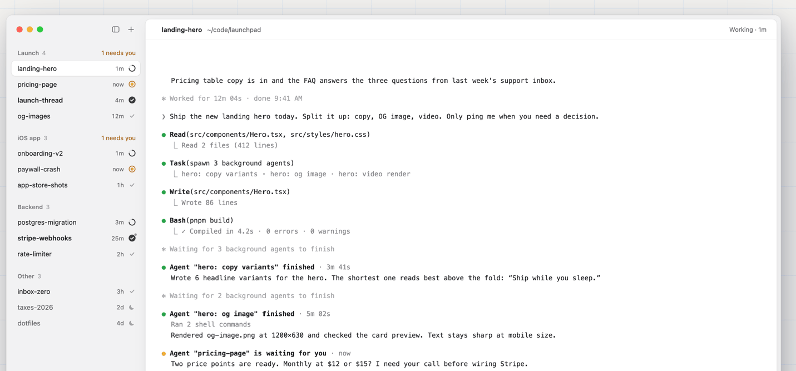
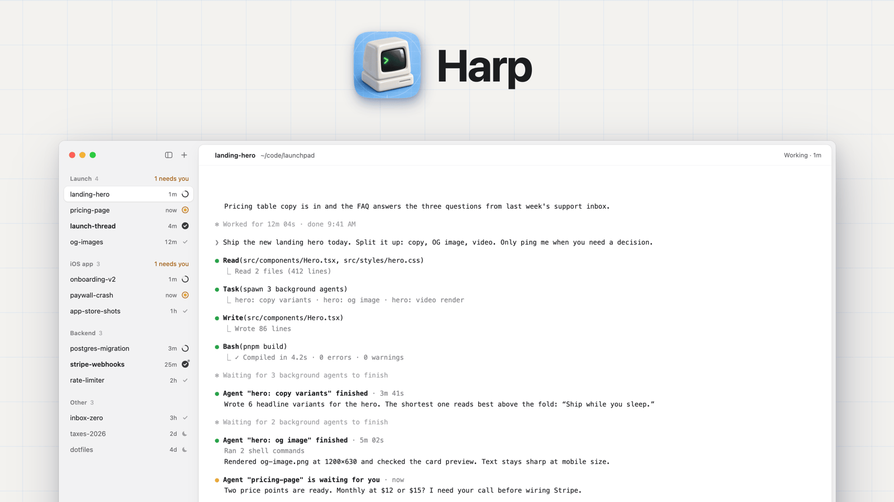

# pigeon UI 规格（侧栏 + 终端）

> 依据：2026-10-27 用户给的参考图（Harp）。**唯一刻意的差异：右栏是终端本体，不是转录视图。**
> 目标是「左边有分组、右边是对应终端」——点左边哪一行，右边就切到那个 pane。

## 0. 参考图

目标形态（左侧分组列表 + 右侧内容区）：



参考图的完整全貌（右侧是转录视图，pigeon 换成终端）：



## 1. 窗口布局

```
┌────────────────────┬──────────────────────────────────────────────────┐
│ ● ● ●      ⇤   +   │  landing-hero   ~/code/launchpad     Working · 1m │
├────────────────────┼──────────────────────────────────────────────────┤
│ Launch  4  1 needs you                                                │
│ ╭────────────────╮ │                                                  │
│ │ landing-hero   │ │                                                  │
│ ╰────────────────╯ │                                                  │
│ pricing-page  now ◷│                                                  │
│ launch-thread  4m ✓│          终端本体（当前选中的 pane）             │
│ og-images     12m ⌄ │                                                  │
│                    │                                                  │
│ iOS app  3  1 needs you                                               │
│ onboarding-v2  1m ◐│                                                  │
│ paywall-crash  now ◷│                                                 │
│ app-store-shots 1h ✓│                                                 │
│                    │                                                  │
│ Backend  3         │                                                  │
│ ···                │                                                  │
└────────────────────┴──────────────────────────────────────────────────┘
```

尺寸（macOS）：
- 窗口：单窗口，圆角，标题栏与侧栏同色，红绿灯内嵌在侧栏顶部（`titlebarAppearsTransparent`）。
- 侧栏：默认 272pt（harp `SIDEBAR_WIDTH`，§7.1），可拖动分隔线 200–360pt；⌘B 折叠/展开。
- 右栏头部：40pt 高；正文（终端）撑满剩余区域，无额外留白。

## 2. 侧栏

### 2.1 结构

```
分组头：<项目名>  <成员数>          [<N needs you>]
行：    <会话/任务名>            <相对时间> <状态图标>
```

- **分组键**：默认按「项目」= pane 的当前工作目录上溯到 git 仓库根；没有 git 时用 cwd 的末级目录名。
  一个项目下的多个会话归到同组；组头显示成员数与需要用户的条数。
- **行**：名称左对齐、单行截断；右侧固定宽度区域放「相对时间 + 图标」，两者垂直居中对齐成一列。
- **选中态**：整行圆角胶囊背景（参考图里 `landing-hero` 那行）。
- **未读**：名称加粗 + 行首小圆点；聚焦该行即清除。
- **悬停**：背景浅一档；行尾出现 `×`（关闭会话，二次确认）。
- **分组不折叠**，可重命名：右键组头 → `Rename Group…`（2026-10-28 用户决定，见 `m3-checklist.md` §3）。

### 2.2 状态图标（来自 OSC 7501）

| OSC 7501 | 图标 | 颜色 | 相对时间含义 |
|---|---|---|---|
| `working` | 旋转弧 `◐` | 蓝 | 该会话上次上报的时间 |
| `blocked`（`kind=permission/question/auth`） | 时钟 `◷` | 橙 | 开始等待的时间（Harp 里是 `now`） |
| `done` | 对勾 `✓` | 绿 | 完成时间 |
| `error` | 感叹号 `!` | 红 | 出错时间 |
| `idle` | 无图标 | 灰 | 最后活动时间 |
| 无上报（进程不像 agent 或没开上报） | 无图标 | 灰 | 最后输出时间 |

- **相对时间**：`now`(<60s) / `Xm` / `Xh` / `Xd`；每分钟刷新一次，不需要精确到秒。
- **排序**：`blocked` 的会话升到组内最前（参考图里 `1 needs you` 的组也是把等待项排前面），其余按时间倒序。
- **组头计数**：`<N> needs you` 只在 N > 0 时显示，与组内 `blocked` 数量一致。

### 2.3 顶部工具条

- 左侧：原生红绿灯。
- 右侧两个按钮：`⇤` 折叠侧栏、`+` 新建会话（下拉：本机 / 远端主机；工作目录默认当前项目）。
- 空状态：**不做**。首次连接到一个没有会话的宿主时，客户端自动新建一个 session（2026-10-28 用户要求），所以不会出现“空列表”。

## 3. 右栏（终端）

- 头部：`<会话名>`（粗体）+ `<cwd>`（次要色，`~` 缩写）以及右侧状态徽标 `Working · 1m`
  （与侧栏同一份状态，措辞用英文与参考图一致；blocked 时显示 `Waiting · permission`）。
- 正文：**pane 的终端本体**，由我们的 VT 视图渲染；分屏就在这块区域里做（嵌套 vsplit/hsplit）。
- 焦点：点击终端 → 键盘进 pane；点击侧栏行 → 切换右栏内容但**不抢键盘焦点**（第二次点击或 Tab 才进终端）。
- 终端内点击链接：`⌘+点击` 打开浏览器；`⌘F` 在 pane 内搜索。

## 4. 交互与快捷键

| 操作 | 键位 |
|---|---|
| 上一个/下一个会话 | `↑` / `↓`（侧栏聚焦时）或 `⌥↑/⌥↓`（终端聚焦时） |
| 跳到下一个 `blocked` | `⌘J` |
| 新建会话 | `⌘T` |
| 拆分当前 pane | `⌘D`（左右）/ `⌘⇧D`（上下） |
| 关闭 pane / 会话 | `⌘W` / `⌘⇧W` |
| 折叠侧栏 | `⌘B` |
| 切换 pane | `⌘[` / `⌘]` |
| 滚动历史 | 触控板/滚轮（pane 内） |

点击侧栏行 = 选中该会话（未订阅过就 `attach`，已订阅则 `focus`），不需要前缀键；tmux 风格前缀键作为可选模式（迁移用户）。

## 5. 数据模型（UI 侧）

```
Project(id, name, session_ids)          # 分组，按 git 根或 cwd 末级目录
Session(id, title, cwd, panes, last_seen_at, unread)
Pane(id, title, status, status_at, kind, msg)   # 直接来自 OSC 7501 记录
```
- 会话标题：优先程序设置的 OSC 0/2 标题，其次 `cwd` 末级目录，最后是序号。
- 状态聚合：一个会话有多个 pane 时，取最紧急的一条（`blocked > error > done > working > idle`），
  行尾可以加 `(2)` 表示第二个 pane 也在等。
- 未读：`done`/`error` 在用户看过该会话前算未读；`blocked` 单独用橙点表示“需要你”。

## 6. 与参考图的差异（有意为之）

2026-10-28 按参考图 + 本文档做了逐项对照（明细表见 `docs/m3-checklist.md` §2.1）。
**色值与尺寸的权威来源是 §7（从 harp 源码抄的规格表）**，本节只讲“哪些一致、哪些有意不同”。现状：

**一致的**：

| 项 | 参考图 | 我们 |
|---|---|---|
| 分组 | 按项目分组，组头 = 项目名 + 条数 | 相同（git 根优先，否则 cwd 末级目录），条数是组内 session 数 |
| 需要你 | 组头右侧橙色 `1 needs you` | 相同位置、相同措辞；口径见下 |
| 行 | 单行：标题左，右侧 `时间 + 图标` | 相同（标题 13pt、时间 10pt、字形 15pt/16pt 槽），行高 30pt + 1pt 间距（§7.1） |
| 状态图标 | spinner / 时钟 / 对勾 / 感叹号 | `◐` 蓝、`◷` 橙、`✓` 绿、`!` 红（§2.2），`idle` 不画 |
| 选中态 | 整行圆角胶囊 | 自绘胶囊：8pt 圆角、`WHITE` 底、0.5pt `SELECTED_EDGE`、投影（`SidebarRowView`） |
| 相对时间 | `now` / `1m` / `12m` / `1h` | `now` / `Xm` / `Xh` / `Xd`，每分钟刷新 |

**有意不同的**：

| 项 | 参考图（Harp） | 我们 | 为什么 |
|---|---|---|---|
| 右栏内容 | 对话/工具调用的转录视图 | **终端本体** | 这是终端应用，不是聊天界面 |
| 行内的状态文案 | 行里没有 `Working · 1m` | 行保持单行（§2.1），这句话放在**右栏头部徽标**；无上报时留空 | 单行放不下状态文案，而 §3 本来就要求头部徽标；2026-10-28 用户确认按参考图做单行 |
| 没有 OSC 7501 记录的 session | Harp 没有这个概念 | 行尾时间与头部徽标**都留空** | 我们的信息源只有 OSC 7501（`AGENTS.md` §1）；不拿“这一行出现的时间”冒充“最后活动时间” |
| 行尾图标 | spinner / 时钟 / 对勾 / chevron / pause | 只做 `◐ ◷ ✓ !` | 不做 chevron/pause（§2.1 的选择态已经表达了选中） |
| 分组折叠 | 可折叠 | 不可折叠，右键 `Rename Group…` 改名 | 2026-10-28 用户决定：分组名比折叠有用 |
| 标题栏 | 红绿灯内嵌在侧栏顶部，透明标题栏 | **已对齐**：`.fullSizeContentView` + `titlebarAppearsTransparent` + 隐藏标题，红绿灯落在 56pt 侧栏头部里，折叠/新建按钮与红绿灯同一行（按原生按钮中心对齐） | 只剩 harp 的窗口玻璃材质模糊（`GLASS_BLUR_RADIUS` 30）没做：那是自绘窗口背景，AppKit 下换系统材质 |
| 悬停 `×` 关闭 | 行尾出现 `×` | 无（右键菜单 / `⌘⇧W`） | 未实现，记在 `m3-checklist.md` §5 |
| 空态 | 无 | 不显示空态：没有会话时自动新建一个（§2.3） | 参考图只是没有零会话的截图 |
| 分屏 | 无 | 右栏内可继续分屏（嵌套） | §1 的终端区就是分屏容器 |

`needs you` 的口径比参考图宽：`blocked`、`error`、以及**未读的 `done`** 都算“要你”（`SidebarModel.needsYou`），
组头数字与该组内这几类会话数一致；`blocked` 仍是排序最优先的一档。

**可选后续**：同一会话加一个「转录视图」开关（读 Pi 的会话日志），与终端切换显示——先不做。

## 7. harp 对齐规格（2026-10-28）

> 出处：`/tmp/harp`（`dominikmartn/harp`，commit `0b14dc426bc0`，2026-10-26），只读参考。
> 许可：AGPL-3.0 / MIT 双许可——**这里只抄数值与色值当规格，不复制代码或资源**。
> 文件缩写：`VT` = `app/src/workspace/view/vertical_tabs.rs`（`mod sidebar`），`TL` = `app/src/util/traffic_lights.rs`。
> harp 的侧栏是自绘的（warpui），所以“取值”列给的是它的数值与色值；pigeon 用 AppKit 原生控件复刻同样的数字。

### 7.1 尺寸与间距

| 项 | 出处 | harp 取值 | pigeon 取值（目标） |
|---|---|---|---|
| 侧栏宽度 | `VT:9110` `SIDEBAR_WIDTH` | 272（可拖） | 默认 272，夹 200–360 |
| 侧栏顶部 header 高（红绿灯那一行） | `VT:9111` `HEADER_HEIGHT` | 56 | 56（红绿灯内嵌 + 右侧两个按钮） |
| 列表左右留白 | `VT:9113` `LIST_SIDE_PADDING` | 10 | 10 |
| 列表顶部留白 | `VT:9114` `LIST_TOP_PADDING` | 4 | 4 |
| 分组之间 | `VT:9115` `SECTION_GAP` | 14 | 14 |
| 行之间 | `VT:9116` `ROW_GAP` | 1 | 1 |
| 行高 | `VT:9117` `ROW_HEIGHT` | 30 | 30 |
| 行圆角 | `VT:9120` `ROW_RADIUS` | 8 | 8（选中/悬停/拖动都是这一个半径） |
| 行内边距 | `VT:10031`（行）`VT:2983`（正文行） | 左 12 / 右 8 | 左 12 / 右 8 |
| 行内元素间距 | `VT:9827` `row_line` spacing | 8 | 8 |
| 组头高 | `VT:9122` `SECTION_HEADER_HEIGHT` | 28 | 28 |
| 组头内边距 | `VT:9816` | 左 12 / 右 9 | 左 12 / 右 9 |
| 状态图标槽 / 字形 | `VT:9521` `STATUS_GLYPH`、`VT:9565` 16×16 槽 | 15 / 16×16 | 15pt 字形、16pt 槽（SF Symbols） |
| 顶部按钮 | `VT:10146-10162` | 28×28、圆角 7、图标 17、悬停 `HOVER` 填充 | 28×28、圆角 7、图标 17、`SidebarHeaderButton` 自绘悬停填充 |
| 右栏头部高 | `VT:9125` `CARD_HEADER_HEIGHT` | 40 | 40 |
| 右栏头部左右留白 | `VT:9127-9128` `CARD_HEADER_PAD_OPEN/CLOSED`、`VT:10945` | 左 32（侧栏开）/ 84（侧栏关），右 20 | 左 32 / 右 20 |
| 右栏头部下边线 | `VT:10945` `Border::new(0.5)` + `DIVIDER` | 0.5pt，颜色跟主题（浅 `#ececef` / 深 `#3a3a3c`） | 0.5pt，`SidebarTheme.divider`（跟外观） |
| 窗口红绿灯区 | `TL:74` `TrafficLightData{width:64, side:Left}` | 左侧 64 宽，harp 自己画窗口所以要留位 | 用 macOS 原生红绿灯：它们本来就在左上 64pt 区里，pigeon 不需要额外占位；折叠/新建芯片按原生按钮中心对齐 |
| 右栏卡片圆角 | `view.rs:579` `FRAMED_CARD_CORNER_RADIUS` | 10 | 10（`CardView` 内层 `cornerCurve = .continuous`） |
| 右栏卡片外缩 | `view.rs:22258-22262` `inset_framed_card()` | 上/右/下各 8，左边贴分隔线 | 同上（8pt 缝露出侧栏底色） |
| 右栏卡片描边 | `view.rs:22245` `Border::all(0.5)` + `CARD_EDGE` | 0.5 | 0.5（`cardEdge`） |
| 右栏卡片投影 | `view.rs:22247-22252` `css_shadow(CARD_SHADOW, 4., 16.)` | 下移 4、模糊 16 | 下移 4、模糊 16（`cardShadow`，`shadowRadius = 8`） |
| 卡片内容左内边距 | `view.rs:585` `FRAMED_CARD_CONTENT_LEFT_PADDING` | 32 | 32（头部与终端内容） |
| 侧栏底部 footer | `VT:9112` `FOOTER_HEIGHT` | 44 | 不做（pigeon 没有 harp 的 footer，见 §6） |
| 终端默认背景 | `default_themes.rs:262` `dark_theme()` / `:275` `light_theme()` 的 `background` | 深 `#050505` / 浅 `#ffffff` | `SidebarTheme.terminalBackground`：浅 `#ffffff`、深 `#050505`（pane 底色与默认格子背景都用它） |
| 终端默认前景 | 同上，`foreground` | 深 `#ffffff` / 浅 `#111111` | `SidebarTheme.terminalForeground`：浅 `#111111`、深 `#ffffff`（只作用于“没有显式颜色”的格子，ANSI 16/256 色不动） |
| 卡片底色 | `view.rs:22241` `with_background(appearance.theme().background())` | = 主题背景 | = `terminalBackground`（浅白、深 `#050505`），所以侧栏与卡片同色系 |
| 未读点 | harp 没有这个元素：它用「标题 Semibold + 实心 done 盘」表达未读（`VT:9544-9555`） | — | 5pt 圆点、`ICON_STRONG`（浅 `#3a3a3c` / 深 `#e5e5ea`），画在标题左侧 5pt；同时标题 Semibold。出处是本档 §2.1 |
| 空态 | harp 没有：列表为空时只剩组头 | — | 不做空态：客户端在“宿主没有会话”时自动新建一个（`applySessions`），所以列表不会空着 |

### 7.2 颜色（浅 / 深）

`VT:9185-9235` 的 `colors` 模块：`tokens!` 宏，每个 token 一对浅/深值；深色由主题的 `ColorScheme::LightOnDark` 选出。

| token | 用处 | 浅色 | 深色 |
|---|---|---|---|
| `INK` | 行标题、右栏会话名 | `#1d1d1f` | `#f5f5f7` |
| `SUB` | 次要文字（shell 图标等） | `#626269` | `#98989f` |
| `GRAY` | 时间、路径、顶部按钮图标 | `#6e6e73` | `#8e8e93` |
| `SECTION_NAME` | 组头项目名 | `#7c7c82` | `#8e8e93` |
| `SECTION_COUNT` | 组头条数 | `#a1a1a6` | `#636366` |
| `NEEDS_TEXT` | 组头 `N needs you` | `#9a5700` | `#f0b35c` |
| `ICON_NEEDS_RING` / `ICON_NEEDS_DOT` | 行内“等待”状态图标（`VT:9222-9223`，使用处 `VT:9583/9588`） | `#c98314` / `#e8a33d` | `#e8a33d` / `#f0b35c` |
| `needs_you_color()` | 等待行的相对时间（`VT:4447`，固定值不经主题） | `#e8a33d` | `#e8a33d` |
| `ICON_STRONG` | working 弧、未读 done 实心盘 | `#3a3a3c` | `#e5e5ea` |
| `ICON_ON_FILL` | 实心盘里被抠掉的勾 | `#ffffff` | `#1c1c1e` | harp 有，pigeon 不用：`checkmark.circle.fill` 自带反色 |
| `RING` | 已读 done 的勾、idle 月亮 | `#a1a1a6` | `#636366` |
| `TRACK` | working 的转圈轨道 | `#e0e0e4` | `#3a3a3e` | harp 有，pigeon 不用：working 用一个 SF Symbol |
| `WHITE` | 选中行底色 | `#ffffff` | `#3a3a3d` |
| `QUIET_SELECTED` | 窗口失焦时的选中底色（`isEmphasized == false`） | `#f4f4f5` | `#2f2f32` |
| `HOVER` | 悬停底色 | 黑 5%（alpha 13） | 白 6%（alpha 15） |
| `SELECTED_EDGE` | 选中行 0.5pt 描边 | 黑 8% | 白 10% |
| `SELECTED_SHADOW` | 选中行投影 | 黑 6% | 黑 25% |
| `DIVIDER` | 右栏头部下边线 | `#ececef` | `#3a3a3c` | 与 harp 一致：`SidebarTheme.divider`（跟外观） |
| `SIDEBAR` | 侧栏不透明底色 | `#e8e8eb` | `#232326` |
| `GLASS_TINT` | 侧栏材质上的半透明罩（`sidebar_fill()`） | `rgba(250,250,252,140)` | `rgba(30,30,32,140)` |
| `BADGE_TEXT` | 顶部按钮角标文字 | `#3a2300` | `#3a2300` | harp 有，pigeon 不用：没有角标 |
| 主题 `background()` | 卡片与终端底色（`view.rs:22241`、`default_themes.rs:262/275`） | `#ffffff` | `#050505` |
| 主题 `foreground()` | 终端默认前景（同上） | `#111111` | `#ffffff` |
| `CARD_EDGE` | 右栏卡片 0.5pt 描边（`view.rs:22245`） | 黑 10%（alpha 26） | 白 10%（alpha 26） |
| `CARD_SHADOW` | 右栏卡片投影（`view.rs:22247`） | 黑 5%（alpha 13） | 黑 25%（alpha 64） |

### 7.3 字号与字重

| 项 | 出处 | harp 取值 | pigeon 取值（目标） |
|---|---|---|---|
| 字体 | `VT:9239-9260` `load_font()` | `.AppleSystemUIFont`（SF Pro Text） | `.systemFont`（同一个字体） |
| 行标题 | `VT:9119` `ROW_TITLE_SIZE`、`VT:9849` | 13，未读 Semibold | 13，未读 Semibold |
| 行时间 | `VT:8568` 10pt；颜色 `VT:8564` → `needs_you_color()` `#E8A33D`（等待）否则 `SUB` | 10pt；blocked 行用 `needsAccent` `#E8A33D`，其余 `GRAY`/`SUB` | 10pt，同上 |
| 组头项目名 | `VT:9123` `SECTION_TITLE_SIZE`、`VT:10130` | 11.5 Semibold，首字母大写 | 11.5 Semibold，首字母大写 |
| 组头条数 | `VT:10092` | 11.5 Normal | 11.5 Normal |
| 组头 `needs you` | `VT:10101` | 12 Normal，`NEEDS_TEXT`；单数 `1 needs you`、复数 `N need you` | 12 Normal，同上（含单复数） |
| 右栏会话名 | `VT:10923` | 12.5 Semibold，`INK` | 12.5 Semibold |
| 右栏路径 | `VT:10926` | 12.5，`GRAY`，**从行首截断** | 12.5，`GRAY`，行首截断 |
| 右栏状态 | `VT:10939` | 12，`GRAY` | 12，`GRAY` |

### 7.4 行尾状态（语义照搬，画法用 SF Symbols）

| harp | 出处 | 画法 | pigeon |
|---|---|---|---|
| `Working` | `VT:9565-9590` | `TRACK` 圆环 + `ICON_STRONG` 弧 | `◐` 或 `circle.dashed` 系 SF Symbol，同色 |
| `Needs` | `VT:9591-9600` | `ICON_NEEDS_RING` 环 + `ICON_NEEDS_DOT` 点 | `exclamationmark.circle`，`iconNeedsRing` |
| `Done`（未读） | `VT:9544-9555` | `ICON_STRONG` 实心盘 + `ICON_ON_FILL` 勾 | 实心对勾，`ICON_STRONG` |
| `Done`（已读） | `VT:9557` | `RING` 细勾 | 细勾，`RING` |
| `Idle` | `VT:9602` | `RING` 月亮 | 月亮，`RING` |
| `Shell`（无 agent） | `VT:9604` | `SUB` 终端图标 | 不画（pigeon 的 idle 行不显示字形，见 §2.2） |
| 时间文案 | `VT:9390` `age_label` | `now` / `5m` / `3h` / `2d` | 一致（`SidebarModel.relativeTime`） |
| 时间起点 | `VT:9410` `age_from` | working 从本轮开始；shell 从最后一条命令；其余从状态变化，退回最后命令 | 只有“状态变化时间”；shell 行留空（`docs/plan.md` §11 已记缺口） |
| 未读 | `VT:9849` | 标题 Semibold + 实心 done 盘 | 标题 Semibold + 行首圆点（§2.1） |

### 7.5 取用范围

- **照搬**：7.1 全部尺寸、7.2 全部 token、7.3 字号字重、7.4 语义与颜色。
- **不照搬**：harp 的 `MENU_*`、`LIFTED_*`（拖动时的悬浮副本）、分组卡片（`TabGroup` 的卡面）、footer、玻璃材质模糊（`GLASS_BLUR_RADIUS`）——这些是它自绘 UI 的专属部件；而**右栏的卡片本身是照搬的**（`CARD_EDGE`/`CARD_SHADOW`/圆角/外缩，见 §7.1 那 6 行）。
- **色值落地方式**：7.2 的每个 token 在 pigeon 里写成 `NSColor(name:dynamicProvider:)`（浅/深各一支），保证切换系统外观即时生效。
