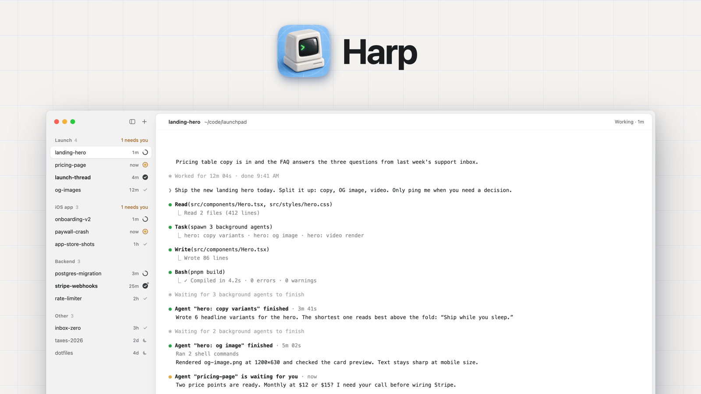

# pigeon UI 规格（侧栏 + 终端）

> **2026-11-04 按 macOS 当前代码核对**。本文 §1–§5 描述已实现行为，§6 列出尚未实现的交互；
> §7 保留 2026-10-28 的 Harp 参考规格与来源，不是当前配色的权威。Linux 尚未实现侧栏，见
> [Linux README](../clients/linux/README.md)。完整能力与缺口见 [plan.md §11](plan.md#11-当前能力与已知缺口)。

## 0. 参考图

原始参考（Harp；pigeon 右栏是终端本体）：

## 1. 窗口布局

- macOS 每个客户端实例建立一个主窗口；多个客户端可以观察同一宿主。透明标题栏、隐藏标题，原生红绿灯内嵌侧栏头部。
- 侧栏默认 272pt，可拖到 200–360pt；顶部 56pt；`⌘B` 收起/展开整条侧栏，项目组本身不折叠。
- 右栏是终端卡片：10pt 圆角，上/右/下外缩 8pt，0.5pt 描边；40pt 头部，终端内容左内边距 32pt。
- 终端使用 Metal；CoreText 仅负责字体度量/字形光栅化。默认系统等宽字体 13pt，行高 1.25；
  `~/.config/pigeon/config.toml` 支持 `font-family`、`font-size`、`line-height`，启动时读取。
- 当前深色：侧栏 `#16171A`、卡片 `#0E0F11`、正文 `#E6E6E6`、needs-you 琥珀色 `#F0B35C`；
  浅色：侧栏 `#E8E8EB`、卡片 `#FFFFFF`、正文 `#111111`。完整 token 以 `SidebarTheme.swift` 为实现依据。

## 2. 侧栏

### 2.1 结构与分组

机器 → 项目组 → 会话行；右侧显示选中会话的 pane 布局。

- 本机项目名优先取会话首次出现时 cwd 的 git 根目录名，否则取目录末级；远端使用宿主上报 cwd 的末级名，不在本机探测远端 git 根。
  组在首次出现时固定，后续 `cd` 不换组；右键可改组名。同名项目在不同机器上分组独立。
- 行首 24pt 圆形程序图标，状态徽标叠在图标角上；标题依次取用户改名、OSC 7501 `app`、宿主提供的程序名。
- 普通行 30pt；有详情时 44pt，第二行 11pt：working/error 有 `msg` 才显示，blocked 无 `msg` 时显示等待原因；done/idle 不显示详情。
- 时间在行尾，采用等宽数字。悬停时用 `×` 替代时间，触发与右键关闭相同的 `onClose` 路径；不承诺额外确认框。
- 未读时标题加粗，done 徽标用实心勾。`done`/`error` 在可见会话被查看后确认；`working`/`blocked` 不因查看而清除。
- 分组内先按状态紧急程度，再按用户保存的顺序，最后按标题自然排序；不是按最后输出时间排序。

### 2.2 状态与计数

| 状态 | 当前表现 | 时间来源 |
|---|---|---|
| working | 中性色旋转弧，有任务文案时显示第二行 | 宿主 `age_ms` 换算的当前状态开始时间 |
| blocked | 琥珀色感叹号圆环，进入 blocked 时柔和脉冲一次 | 同上 |
| done | 未读实心勾；已读细勾 | 同上 |
| error | 红色警告符号，可显示错误 `msg` | 同上 |
| idle | 无状态徽标，头部状态文案为空 | 有记录时可显示记录时间 |
| 无上报 | 无状态徽标、无相对时间，不推断 agent 状态 | 无 |

- 时间文案：`now`（<60s）、`Xm`、`Xh`、`Xd`。同一状态重复上报不重置宿主记录的开始时间。
- `needs you` 计数包含 **blocked、error、未读 done**，按会话行计数；单数 `1 needs you`，复数 `N need you`。
- `⌘J` 按会话 id 循环寻找上述任一需要用户的会话，不保证只跳 blocked，也不按紧急程度重新排序。
- 多客户端时行尾附带 `2× latest` 等尺寸来源。客户端目前未提供选择 `smallest` / `locked` 的 UI。
- **聚合**：按各 pane 最新状态的紧急程度生成会话行，保留来源 pane；⌘J 定位来源并解除 zoom。确认只针对实际可见 pane（前台、key window、非遮挡、已有快照），隐藏兄弟保留未读。重连重复终态不累加；同 pane 多记录完整同步与跨应用重启去重仍待补。
- 动效尊重 Reduce Motion；尚未完成整套 VoiceOver/终端文本无障碍验收。桌面通知投递未实现。

### 2.3 顶部工具条与主机

原生红绿灯右侧是收起侧栏与 `+`。`+` 菜单依次提供本机新会话、已保存 SSH 主机的新会话/连接、`Connect to Host…`。
连接中的主机项不可重复启动。机器列表显示连接状态，离线主机不产生在线会话行。
首次连接一个没有会话的宿主时自动新建会话；关闭最后一个会话不会自动重生。

## 3. 右栏与终端操作

- 头部：会话名、cwd、状态文案，例如 `Working · 3m · Refactoring the renderer` 或 `Needs you · 2m · Run tests?`。
  未上报或 idle 时状态留空；不可信的程序文案始终是纯文本。
- 右栏按宿主布局树展示 pane，可拖动分隔线、切焦点与 zoom；切回后恢复原布局。
- 点击侧栏会话后，焦点立即交给相应 pane；无需第二次点击才能打字。
- 滚轮/触控板、PageUp/PageDown 回看宿主历史；备用屏优先交给应用，不回看；打字回到底部。
- 拖动选择、双击选词、三击选行；`⌘C`/`⌘V` 复制粘贴，粘贴经宿主按 bracketed-paste 模式包装。
  `⌘A` 只选择当前屏幕；尚不能跨整个历史选择，复制按核心软换行标志合并自动折行，保留真实换行与折行处空格（旧宿主不发标志时仍按网格行换行）。
- 中文等输入走 `NSTextInputClient`，preedit 在客户端画，提交后才发宿主；Option as Meta 可在 View 菜单切换。

## 4. 已实现快捷键

| 操作 | 键位 |
|---|---|
| 跳到下一个 needs-you 会话 | `⌘J` |
| 新建会话 | `⌘T` |
| 连接主机 | `⌘⇧O` |
| 拆分当前 pane | `⌘D`（左右）/ `⌘⇧D`（上下） |
| 关闭 pane / 会话 | `⌘W` / `⌘⇧W` |
| 收起/展开侧栏 | `⌘B` |
| 切换 pane | `⌘[` / `⌘]` |
| zoom / unzoom | `⌘⇧↩` |
| 回看 | 滚轮/触控板、PageUp/PageDown |
| 复制 / 粘贴 / 选择当前屏幕 | `⌘C` / `⌘V` / `⌘A` |

关闭所有已连接主机的最后一个会话时客户端退出；宿主断线、启动时无会话不会触发此规则。
退出客户端保留宿主任务；主动结束本机宿主用 `End All Sessions on This Mac…`（有确认）。

## 5. 数据归属

核心负责 OSC 7501 解析、记录生命周期、VT、布局和协议；客户端保存 `SessionRef(host, session)` 标识、会话行、
分组、排序、未读与派生文案。macOS 实现在 `SidebarModel` / `SessionReducer` / `Grouping` / `SessionRow`。
程序标题只用于命名，不能用来猜 working/blocked。

## 6. 尚未实现的交互

- `⌘F` 搜索、`⌘+点击` 打开 OSC 8 链接、OSC 52 远端复制。
- `⌥↑/⌥↓` 会话导航、可自定义键位、tmux 前缀模式。
- 跨历史选择、完整字素、命令边界导航/命令输出块。
- 同 pane 多记录完整同步、跨应用重启未读去重、桌面通知、Linux 侧栏与上述日常操作对齐。

这些是待办，不应在快捷键或能力清单中写成可用。优先级见 [plan.md §11](plan.md#11-当前能力与已知缺口)。

## 7. harp 对齐规格（2026-10-28 历史参考）

> 下表保留当时的取值与对齐目标；后续双行、图标角标、悬停关闭及深色主题调整以 §1–§2 和当前代码为准。

> 出处：`/tmp/harp`（`dominikmartn/harp`，commit `0b14dc426bc0`，2026-10-26），只读参考。
> 许可：AGPL-3.0 / MIT 双许可——**这里只抄数值与色值当规格，不复制代码或资源**。
> 文件缩写：`VT` = `app/src/workspace/view/vertical_tabs.rs`（`mod sidebar`），`TL` = `app/src/util/traffic_lights.rs`。
> harp 的侧栏是自绘的（warpui），所以“取值”列给的是它的数值与色值；pigeon 用 AppKit 原生控件复刻同样的数字。

### 7.1 尺寸与间距

| 项 | 出处 | harp 取值 | pigeon 取值（目标） |
|---|---|---|---|
| 侧栏宽度 | `VT:9110` `SIDEBAR_WIDTH` | 272（可拖） | 默认 272，夹 200–360 |
| 侧栏顶部 header 高（红绿灯那一行） | `VT:9111` `HEADER_HEIGHT` | 56 | 56（红绿灯内嵌 + 右侧两个按钮） |
| 列表左右留白 | `VT:9113` `LIST_SIDE_PADDING` | 10 | 10 |
| 列表顶部留白 | `VT:9114` `LIST_TOP_PADDING` | 4 | 4 |
| 分组之间 | `VT:9115` `SECTION_GAP` | 14 | 14 |
| 行之间 | `VT:9116` `ROW_GAP` | 1 | 1 |
| 行高 | `VT:9117` `ROW_HEIGHT` | 30 | 30 |
| 行圆角 | `VT:9120` `ROW_RADIUS` | 8 | 8（选中/悬停/拖动都是这一个半径） |
| 行内边距 | `VT:10031`（行）`VT:2983`（正文行） | 左 12 / 右 8 | 左 12 / 右 8 |
| 行内元素间距 | `VT:9827` `row_line` spacing | 8 | 8 |
| 组头高 | `VT:9122` `SECTION_HEADER_HEIGHT` | 28 | 28 |
| 组头内边距 | `VT:9816` | 左 12 / 右 9 | 左 12 / 右 9 |
| 状态图标槽 / 字形 | `VT:9521` `STATUS_GLYPH`、`VT:9565` 16×16 槽 | 15 / 16×16 | 15pt 字形、16pt 槽（SF Symbols） |
| 顶部按钮 | `VT:10146-10162` | 28×28、圆角 7、图标 17、悬停 `HOVER` 填充 | 28×28、圆角 7、图标 17、`SidebarHeaderButton` 自绘悬停填充 |
| 右栏头部高 | `VT:9125` `CARD_HEADER_HEIGHT` | 40 | 40 |
| 右栏头部左右留白 | `VT:9127-9128` `CARD_HEADER_PAD_OPEN/CLOSED`、`VT:10945` | 左 32（侧栏开）/ 84（侧栏关），右 20 | 左 32 / 右 20 |
| 右栏头部下边线 | `VT:10945` `Border::new(0.5)` + `DIVIDER` | 0.5pt，颜色跟主题（浅 `#ececef` / 深 `#3a3a3c`） | 0.5pt，`SidebarTheme.divider`（跟外观） |
| 窗口红绿灯区 | `TL:74` `TrafficLightData{width:64, side:Left}` | 左侧 64 宽，harp 自己画窗口所以要留位 | 用 macOS 原生红绿灯：它们本来就在左上 64pt 区里，pigeon 不需要额外占位；折叠/新建芯片按原生按钮中心对齐 |
| 右栏卡片圆角 | `view.rs:579` `FRAMED_CARD_CORNER_RADIUS` | 10 | 10（`CardView` 内层 `cornerCurve = .continuous`） |
| 右栏卡片外缩 | `view.rs:22258-22262` `inset_framed_card()` | 上/右/下各 8，左边贴分隔线 | 同上（8pt 缝露出侧栏底色） |
| 右栏卡片描边 | `view.rs:22245` `Border::all(0.5)` + `CARD_EDGE` | 0.5 | 0.5（`cardEdge`） |
| 右栏卡片投影 | `view.rs:22247-22252` `css_shadow(CARD_SHADOW, 4., 16.)` | 下移 4、模糊 16 | 下移 4、模糊 16（`cardShadow`，`shadowRadius = 8`） |
| 卡片内容左内边距 | `view.rs:585` `FRAMED_CARD_CONTENT_LEFT_PADDING` | 32 | 32（头部与终端内容） |
| 侧栏底部 footer | `VT:9112` `FOOTER_HEIGHT` | 44 | 不做（pigeon 没有 harp 的 footer，见 §6） |
| 终端默认背景 | `default_themes.rs:262` `dark_theme()` / `:275` `light_theme()` 的 `background` | 深 `#050505` / 浅 `#ffffff` | `SidebarTheme.terminalBackground`：浅 `#ffffff`、深 `#050505`（pane 底色与默认格子背景都用它） |
| 终端默认前景 | 同上，`foreground` | 深 `#ffffff` / 浅 `#111111` | `SidebarTheme.terminalForeground`：浅 `#111111`、深 `#ffffff`（只作用于“没有显式颜色”的格子，ANSI 16/256 色不动） |
| 卡片底色 | `view.rs:22241` `with_background(appearance.theme().background())` | = 主题背景 | = `terminalBackground`（浅白、深 `#050505`），所以侧栏与卡片同色系 |
| 未读点 | harp 没有这个元素：它用「标题 Semibold + 实心 done 盘」表达未读（`VT:9544-9555`） | — | 5pt 圆点、`ICON_STRONG`（浅 `#3a3a3c` / 深 `#e5e5ea`），画在标题左侧 5pt；同时标题 Semibold。出处是本档 §2.1 |
| 空态 | harp 没有：列表为空时只剩组头 | — | 不做空态：客户端在“宿主没有会话”时自动新建一个（`applySessions`），所以列表不会空着 |

### 7.2 颜色（浅 / 深）

`VT:9185-9235` 的 `colors` 模块：`tokens!` 宏，每个 token 一对浅/深值；深色由主题的 `ColorScheme::LightOnDark` 选出。

| token | 用处 | 浅色 | 深色 |
|---|---|---|---|
| `INK` | 行标题、右栏会话名 | `#1d1d1f` | `#f5f5f7` |
| `SUB` | 次要文字（shell 图标等） | `#626269` | `#98989f` |
| `GRAY` | 时间、路径、顶部按钮图标 | `#6e6e73` | `#8e8e93` |
| `SECTION_NAME` | 组头项目名 | `#7c7c82` | `#8e8e93` |
| `SECTION_COUNT` | 组头条数 | `#a1a1a6` | `#636366` |
| `NEEDS_TEXT` | 组头 `N needs you` | `#9a5700` | `#f0b35c` |
| `ICON_NEEDS_RING` / `ICON_NEEDS_DOT` | 行内“等待”状态图标（`VT:9222-9223`，使用处 `VT:9583/9588`） | `#c98314` / `#e8a33d` | `#e8a33d` / `#f0b35c` |
| `needs_you_color()` | 等待行的相对时间（`VT:4447`，固定值不经主题） | `#e8a33d` | `#e8a33d` |
| `ICON_STRONG` | working 弧、未读 done 实心盘 | `#3a3a3c` | `#e5e5ea` |
| `ICON_ON_FILL` | 实心盘里被抠掉的勾 | `#ffffff` | `#1c1c1e` | harp 有，pigeon 不用：`checkmark.circle.fill` 自带反色 |
| `RING` | 已读 done 的勾、idle 月亮 | `#a1a1a6` | `#636366` |
| `TRACK` | working 的转圈轨道 | `#e0e0e4` | `#3a3a3e` | harp 有，pigeon 不用：working 用一个 SF Symbol |
| `WHITE` | 选中行底色 | `#ffffff` | `#3a3a3d` |
| `QUIET_SELECTED` | 窗口失焦时的选中底色（`isEmphasized == false`） | `#f4f4f5` | `#2f2f32` |
| `HOVER` | 悬停底色 | 黑 5%（alpha 13） | 白 6%（alpha 15） |
| `SELECTED_EDGE` | 选中行 0.5pt 描边 | 黑 8% | 白 10% |
| `SELECTED_SHADOW` | 选中行投影 | 黑 6% | 黑 25% |
| `DIVIDER` | 右栏头部下边线 | `#ececef` | `#3a3a3c` | 与 harp 一致：`SidebarTheme.divider`（跟外观） |
| `SIDEBAR` | 侧栏不透明底色 | `#e8e8eb` | `#232326` |
| `GLASS_TINT` | 侧栏材质上的半透明罩（`sidebar_fill()`） | `rgba(250,250,252,140)` | `rgba(30,30,32,140)` |
| `BADGE_TEXT` | 顶部按钮角标文字 | `#3a2300` | `#3a2300` | harp 有，pigeon 不用：没有角标 |
| 主题 `background()` | 卡片与终端底色（`view.rs:22241`、`default_themes.rs:262/275`） | `#ffffff` | `#050505` |
| 主题 `foreground()` | 终端默认前景（同上） | `#111111` | `#ffffff` |
| `CARD_EDGE` | 右栏卡片 0.5pt 描边（`view.rs:22245`） | 黑 10%（alpha 26） | 白 10%（alpha 26） |
| `CARD_SHADOW` | 右栏卡片投影（`view.rs:22247`） | 黑 5%（alpha 13） | 黑 25%（alpha 64） |

### 7.3 字号与字重

| 项 | 出处 | harp 取值 | pigeon 取值（目标） |
|---|---|---|---|
| 字体 | `VT:9239-9260` `load_font()` | `.AppleSystemUIFont`（SF Pro Text） | `.systemFont`（同一个字体） |
| 行标题 | `VT:9119` `ROW_TITLE_SIZE`、`VT:9849` | 13，未读 Semibold | 13，未读 Semibold |
| 行时间 | `VT:8568` 10pt；颜色 `VT:8564` → `needs_you_color()` `#E8A33D`（等待）否则 `SUB` | 10pt；blocked 行用 `needsAccent` `#E8A33D`，其余 `GRAY`/`SUB` | 10pt，同上 |
| 组头项目名 | `VT:9123` `SECTION_TITLE_SIZE`、`VT:10130` | 11.5 Semibold，首字母大写 | 11.5 Semibold，首字母大写 |
| 组头条数 | `VT:10092` | 11.5 Normal | 11.5 Normal |
| 组头 `needs you` | `VT:10101` | 12 Normal，`NEEDS_TEXT`；单数 `1 needs you`、复数 `N need you` | 12 Normal，同上（含单复数） |
| 右栏会话名 | `VT:10923` | 12.5 Semibold，`INK` | 12.5 Semibold |
| 右栏路径 | `VT:10926` | 12.5，`GRAY`，**从行首截断** | 12.5，`GRAY`，行首截断 |
| 右栏状态 | `VT:10939` | 12，`GRAY` | 12，`GRAY` |

### 7.4 行尾状态（语义照搬，画法用 SF Symbols）

| harp | 出处 | 画法 | pigeon |
|---|---|---|---|
| `Working` | `VT:9565-9590` | `TRACK` 圆环 + `ICON_STRONG` 弧 | `◐` 或 `circle.dashed` 系 SF Symbol，同色 |
| `Needs` | `VT:9591-9600` | `ICON_NEEDS_RING` 环 + `ICON_NEEDS_DOT` 点 | `exclamationmark.circle`，`iconNeedsRing` |
| `Done`（未读） | `VT:9544-9555` | `ICON_STRONG` 实心盘 + `ICON_ON_FILL` 勾 | 实心对勾，`ICON_STRONG` |
| `Done`（已读） | `VT:9557` | `RING` 细勾 | 细勾，`RING` |
| `Idle` | `VT:9602` | `RING` 月亮 | 月亮，`RING` |
| `Shell`（无 agent） | `VT:9604` | `SUB` 终端图标 | 不画（pigeon 的 idle 行不显示字形，见 §2.2） |
| 时间文案 | `VT:9390` `age_label` | `now` / `5m` / `3h` / `2d` | 一致（`SidebarModel.relativeTime`） |
| 时间起点 | `VT:9410` `age_from` | working 从本轮开始；shell 从最后一条命令；其余从状态变化，退回最后命令 | 只有“状态变化时间”；shell 行留空（`docs/plan.md` §11 已记缺口） |
| 未读 | `VT:9849` | 标题 Semibold + 实心 done 盘 | 标题 Semibold + 行首圆点（§2.1） |

### 7.5 取用范围

- **照搬**：7.1 全部尺寸、7.2 全部 token、7.3 字号字重、7.4 语义与颜色。
- **不照搬**：harp 的 `MENU_*`、`LIFTED_*`（拖动时的悬浮副本）、分组卡片（`TabGroup` 的卡面）、footer、玻璃材质模糊（`GLASS_BLUR_RADIUS`）——这些是它自绘 UI 的专属部件；而**右栏的卡片本身是照搬的**（`CARD_EDGE`/`CARD_SHADOW`/圆角/外缩，见 §7.1 那 6 行）。
- **色值落地方式**：7.2 的每个 token 在 pigeon 里写成 `NSColor(name:dynamicProvider:)`（浅/深各一支），保证切换系统外观即时生效。
